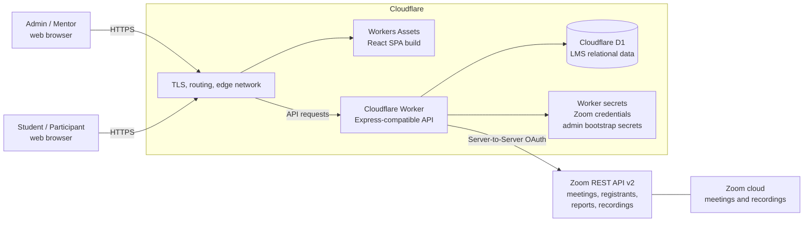
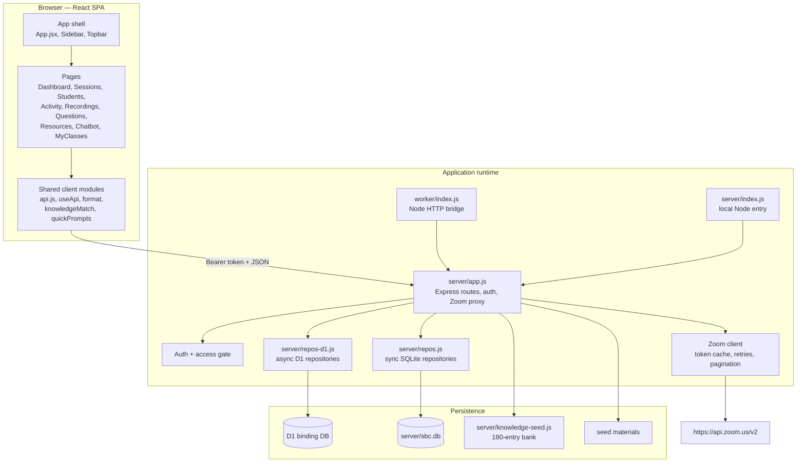
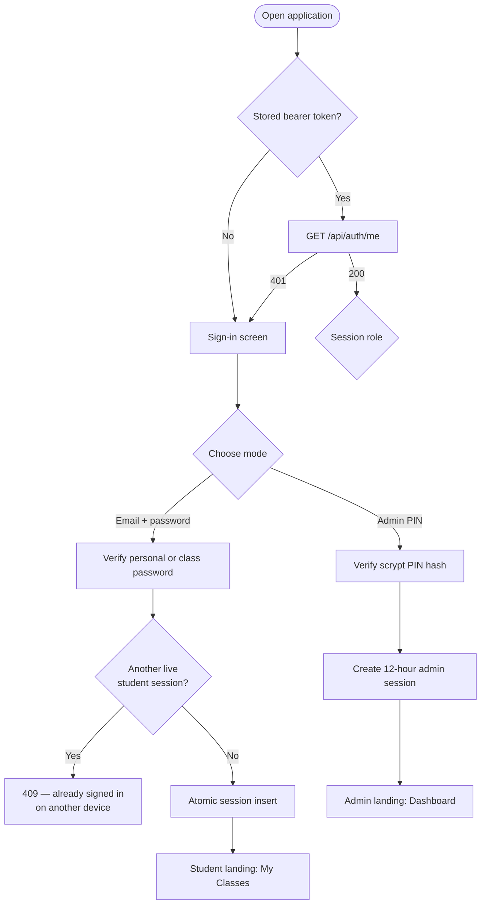
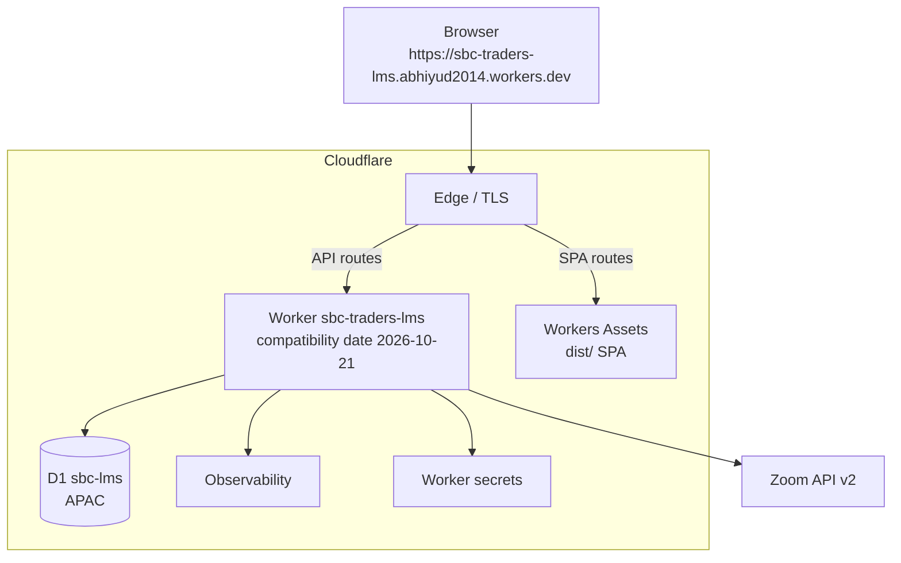
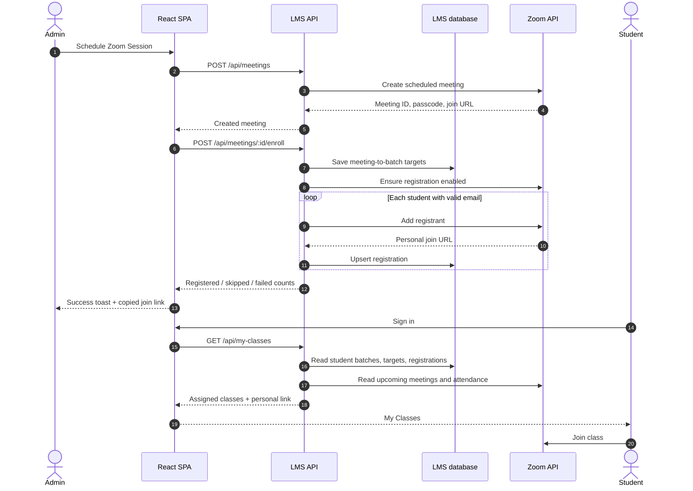
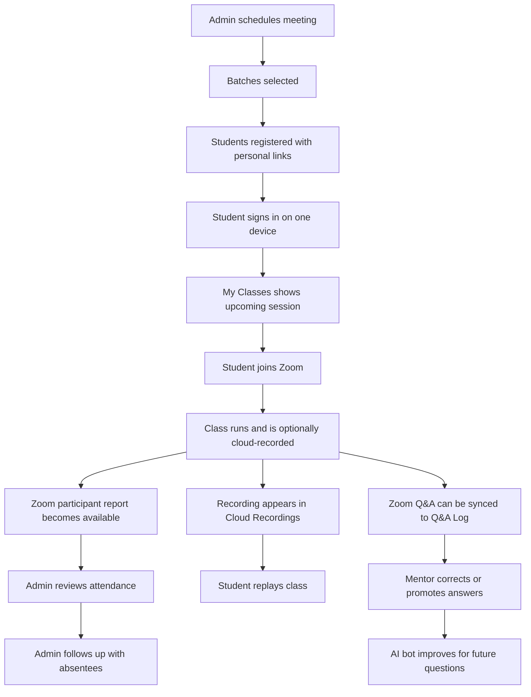
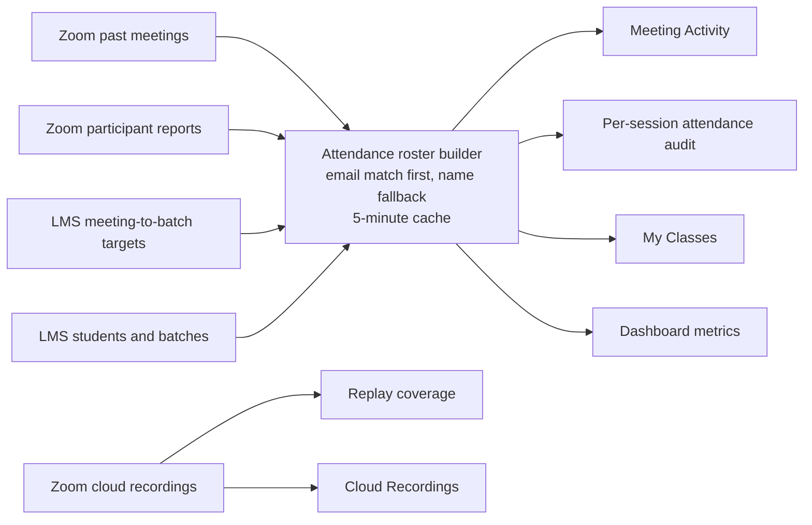
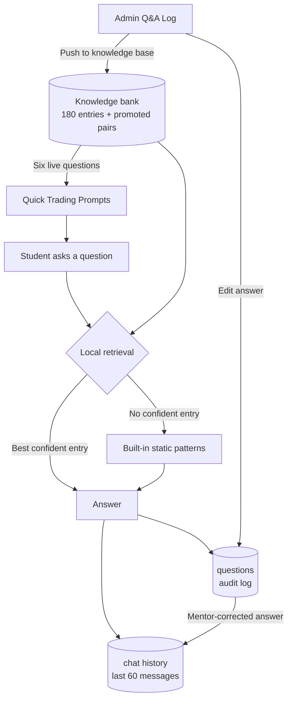
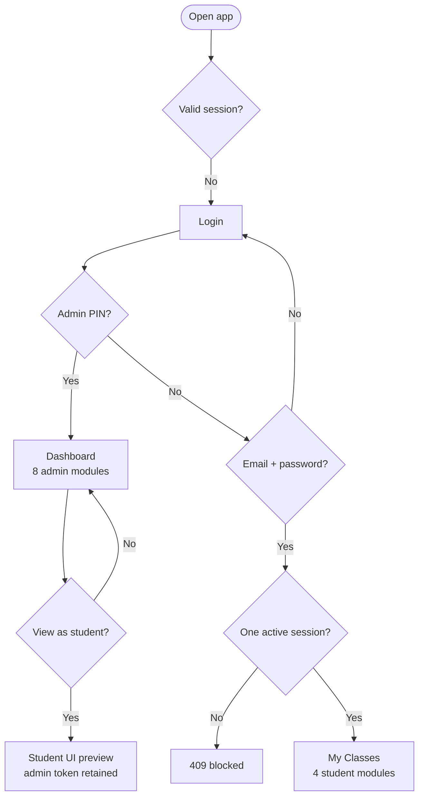
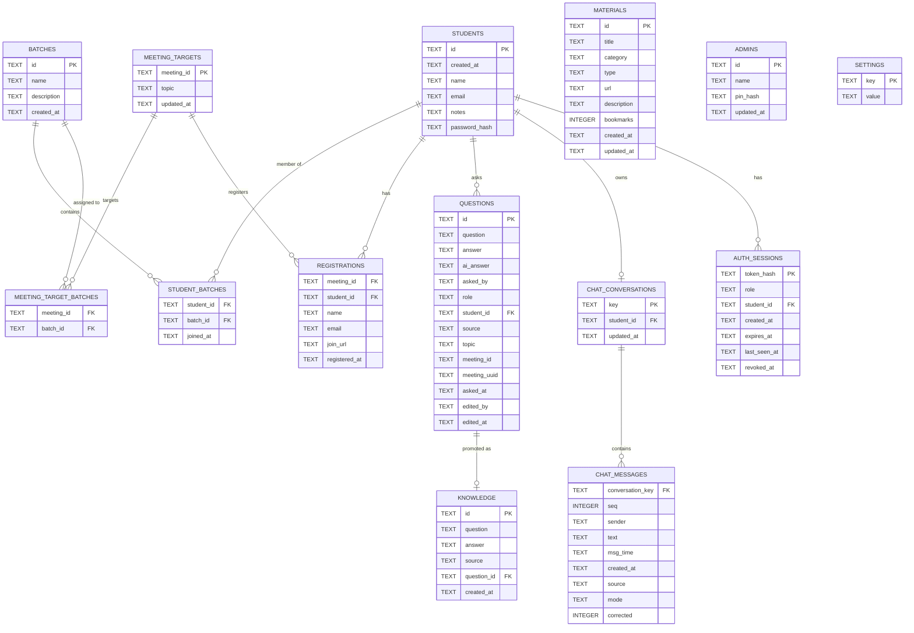

# SBC-LMS — Complete Application Documentation

**Application:** SBC Traders — Trading Academy LMS (SBC-LMS)  
**Document version:** 1.0  
**Last updated:** 22 October 2026  
**Documented revision:** current local codebase and live Cloudflare deployment  
**Audience:** academy administrators, mentors, students, developers, and operators

> This document describes the application, its workflows, architecture, infrastructure, security model, data model, API surface, and operational runbook. It intentionally contains **no credentials, PINs, password hashes, generated seed data, or private student records**.

---

## Contents

1. [About the application](#1-about-the-application)
2. [Product at a glance](#2-product-at-a-glance)
3. [Roles, access, and sign-in](#3-roles-access-and-sign-in)
4. [System architecture](#4-system-architecture)
5. [Components](#5-components)
6. [Technology stack](#6-technology-stack)
7. [Infrastructure and deployment](#7-infrastructure-and-deployment)
8. [Local development](#8-local-development)
9. [Administrator guide](#9-administrator-guide)
10. [Student guide](#10-student-guide)
11. [End-to-end workflows and diagrams](#11-end-to-end-workflows-and-diagrams)
12. [Data model](#12-data-model)
13. [API reference](#13-api-reference)
14. [Security model and hardening notes](#14-security-model-and-hardening-notes)
15. [Operations runbook](#15-operations-runbook)
16. [Troubleshooting](#16-troubleshooting)
17. [Limitations and roadmap](#17-limitations-and-roadmap)
18. [Glossary](#18-glossary)
19. [Related documents](#19-related-documents)

---

## 1. About the application

SBC-LMS is a single-tenant, Zoom-integrated learning management system for a trading academy. It gives the academy one place to:

- schedule and manage live Zoom classes;
- enrol students into cohorts (batches);
- register students for meetings with individual join links;
- audit who actually attended and for how long;
- publish cloud recordings and reference material;
- capture every student question, including questions asked inside Zoom;
- correct and promote answers into a searchable knowledge base;
- provide a local AI-style study assistant;
- announce class updates to students.

The application does **not** host live video itself. Zoom remains the video platform and the source of truth for meetings, registrants, attendance reports, and cloud recordings. SBC-LMS adds the academy layer: identity, cohorts, enrolment, attendance auditing, Q&A, reference content, and a knowledge assistant.

The interface is a React single-page application (SPA). The same Express API runs in two environments:

| Environment | API runtime | Database | Static frontend |
|---|---|---|---|
| Local development | Node.js + Express | `node:sqlite` file | Vite dev server |
| Production | Cloudflare Worker (Node HTTP compatibility) | Cloudflare D1 | Workers Assets |

The live deployment is:

**https://sbc-traders-lms.abhiyud2014.workers.dev**

---

## 2. Product at a glance

### 2.1 Key capabilities

| Capability | Summary |
|---|---|
| Role-based sign-in | Admin signs in with a secret PIN; students sign in with their registered email and a class or personal password. |
| Single active student session | A student can be signed in on only one device/browser at a time. A second login is rejected with HTTP `409`. |
| Admin dashboard | Live Zoom status, active students, upcoming sessions, class hours, webinar status, next session, quick actions, and replay coverage. |
| Zoom session management | Create, edit, delete, list, and join real Zoom meetings; copy join links; manage registrants. |
| Batch management | Create cohorts, assign students to one or more batches, and see member counts. |
| One-click enrolment | Selecting batches when scheduling (or later) registers every student who has an email and stores a personal join link. |
| Attendance auditing | Compare expected students (assigned batches) with actual Zoom joins, duration, reconnect count, and guests. |
| Cloud recordings | Browse Zoom cloud recordings, open playback or download links, and open the share page. |
| Meeting activity | Browse past session instances in a date range and inspect raw or deduplicated attendee lists. |
| Q&A audit log | Every bot question is logged with attribution; Zoom in-meeting Q&A can be merged; the mentor can answer, correct, and promote answers. |
| AI Knowledge Bot | A local, deterministic retrieval assistant over a 180-entry knowledge bank plus mentor-approved answers. It is **not** an external LLM. |
| Dynamic quick prompts | Six starter questions are drawn from the live knowledge bank; **Shuffle** shows another set. |
| Reference Hub | Admin-managed materials with level, type, description, and URL; students browse and open them. |
| Broadcast | Compose an announcement, copy it, copy recipient addresses, or open the local mail client with recipients in BCC. |
| Admin preview | An admin can preview the student experience for any enrolled student without creating a second account or changing session role. |
| Local/production parity | The same Express routes power local Node and Cloudflare Workers; only the repository and static-serving layers differ. |

### 2.2 Product boundaries

SBC-LMS is an academy operations and learning companion. It is not:

- a replacement for Zoom;
- a payment, invoicing, or CRM system;
- a certificate or examination platform;
- an external large-language-model chatbot;
- an email delivery service;
- a multi-tenant SaaS product.

---

## 3. Roles, access, and sign-in

### 3.1 Role model

The application has two authenticated roles:

| Role | UI name | Authentication | Session limit | Landing page |
|---|---|---|---|---|
| `admin` | Admin (Host) / Head Mentor | Secret admin PIN | Unlimited concurrent admin sessions | Dashboard |
| `participant` | Student / Participant | Registered email + class or personal password | Exactly one active student session | My Classes |

There is no separate teacher, assistant, or accountant role. The admin role is the single mentor/host role and has full access.

### 3.2 Sign-in screen

The sign-in screen presents two modes:

- **Admin (Host)**
- **Student**

The form is deliberately simple. Wrong student credentials return the same generic error; a separate setup message is shown when the academy has no class password configured.

#### Admin sign-in

1. Open the application.
2. Select **Admin (Host)**.
3. Enter the **Admin PIN**.
4. Select **Sign in**.

On success, the API returns a bearer token and the admin lands on **Dashboard Overview**. The admin PIN is verified against a slow password hash stored in the database. The PIN is provisioned from the server environment on boot; the value itself is never exposed to the browser and must never be committed or documented.

#### Student sign-in

1. Open the application.
2. Select **Student**.
3. Enter the **email** the mentor registered for the student.
4. Enter the **class password** shared by the mentor, or the student's **personal password** if they changed it.
5. Select **Sign in**.

On success, the student lands on **My Classes**.

If the mentor has not set a class password and the student has no personal password, sign-in returns a setup message telling the student to ask the mentor to set the class password from **Students & Batches → Class login password**.

### 3.3 One active student session

This is an intentional product rule, not a browser-only check.

- A student session has a fixed **12-hour lifetime from sign-in**.
- Only one non-expired, non-revoked participant session may exist per student.
- The database performs the check and insert atomically.
- A second login from another device/browser is rejected with HTTP `409` and this message:

> This account is already signed in on another device. Sign out there first, or ask your mentor to end that session.

Ways to free the device:

1. **Student:** use **Sign out** in the account menu.
2. **Admin:** open **Students & Batches → Enrolled**, use the sign-out-device action for that student, and confirm.
3. **Admin:** set or reset the student's personal password; this revokes the student's active sessions.
4. Wait for the 12-hour session to expire.

Admin sessions are not limited to one device. The one-session rule applies only to students.

### 3.4 Session lifecycle

| Event | Behaviour |
|---|---|
| Successful sign-in | A random bearer token is issued. Only its SHA-256 hash is stored. |
| Page reload | The SPA calls `GET /api/auth/me` to validate the stored token. |
| Sign-out | The token row is deleted/revoked and the browser token is cleared. |
| Expiry | Expiry is fixed at 12 hours from sign-in; activity does not extend it. |
| Password reset by admin | The student's active sessions are revoked so the new password takes effect on a new login. |
| Student deleted | An existing session is invalidated on the next request; the session is deleted. |
| Admin release | `DELETE /api/students/:id/sessions` revokes the student's active sessions. |
| Server restart | Sessions survive because they are stored in the database, not in process memory. |

### 3.5 Landing pages and navigation

#### Admin landing page

After admin sign-in the app opens **Dashboard Overview**. Its subtitle is:

> Institution key metrics, upcoming Zoom sessions & live activity.

The admin landing page contains:

- Zoom connection status and token cache information;
- four headline metrics: **Active Students (30d)**, **Upcoming Sessions**, **Class Hours (30d)**, and **Webinars**;
- the next-session spotlight with **Manage sessions** and **Launch Zoom**;
- **Quick Institution Tools**;
- **Next sessions on your account**;
- **Replay coverage** for the last 14 days.

#### Student landing page

After student sign-in the app opens **My Classes**. Its subtitle is:

> Sessions assigned to your batches, personalised join links and attendance.

The student landing page contains:

- student name, email, and batch badges;
- **References** and **Ask the AI bot** actions;
- four stats: **Upcoming classes**, **Attended**, **Missed**, and **Class time**;
- **Upcoming classes** with **Personal link** or **Shared link**, **Join class**, and copy-link action;
- **Past classes (attendance)** with joined duration or **Absent**.

#### Exact navigation labels

**Admin — 8 modules**

| Order | Sidebar label | Page title | Purpose |
|---|---|---|---|
| 1 | **Dashboard** | Dashboard Overview | Institution metrics, next session, replay coverage. |
| 2 | **Zoom Sessions** | Zoom Sessions & Calendar | Create and manage meetings, registrants, enrolment, attendance. |
| 3 | **Meeting Activity** | Meeting Activity | Past session instances and attendee lists. |
| 4 | **Cloud Recordings** | Cloud Recordings | Zoom cloud recording library. |
| 5 | **Students & Batches** | Students & Batches | Students, cohorts, class password, attendance roster. |
| 6 | **Q&A Log** | Q&A Audit Log | Questions, answers, corrections, knowledge promotion. |
| 7 | **Reference Hub** | Reference Hub & Materials | Curated guides and resources. |
| 8 | **AI Knowledge Bot** | AI Knowledge-Base & Live Chat | Local study assistant and chat history. |

**Student — 4 modules**

| Order | Sidebar label | Page title | Purpose |
|---|---|---|---|
| 1 | **My Classes** | My Classes | Assigned sessions, join links, attendance. |
| 2 | **Cloud Recordings** | Cloud Recordings | Recording library. |
| 3 | **Reference Hub** | Reference Hub & Materials | Read-only resource library. |
| 4 | **AI Knowledge Bot** | AI Knowledge-Base & Live Chat | Local study assistant and chat history. |

The sidebar shows **Main Menu** for admins and **My Learning** for students. The **Zoom Sessions** item carries a **Live** badge; the **AI Knowledge Bot** item carries a **Demo** badge.

#### Top bar

**Admin**

- **Broadcast** (opens the announcement composer);
- **Schedule Zoom** (opens the create-session form from any admin page);
- account menu with **View the app as** → **Admin (Host)** or a student under **Participants**;
- **Sign out**.

**Student**

- account menu labelled **Signed in as student**;
- **Change password**;
- **Sign out**.

The top bar displays the current page title and subtitle, the user's initials, an **ADMIN** or **PARTICIPANT** badge, and Zoom connection status in the sidebar/footer.

### 3.6 Access matrix

| Feature | Admin | Student |
|---|---|---|
| Dashboard | Yes | No |
| Zoom Sessions management | Yes | No |
| Meeting Activity | Yes | No |
| Cloud Recordings | Yes | Yes, read-only |
| Students & Batches | Yes | No |
| Q&A Log | Yes | No |
| Reference Hub | Add/edit/delete | Read-only |
| AI Knowledge Bot | Yes | Yes |
| Broadcast | Yes | No |
| Change password | No (PIN-based) | Yes |
| One active session rule | No | Yes |
| Admin preview of student UI | Yes | Not applicable |

Server-side enforcement is default-deny for participants. The UI hiding a module is not the security boundary.

### 3.7 Admin preview (“view as”)

An admin can inspect the platform as any enrolled student:

1. Open the account menu.
2. Under **View the app as**, choose **Admin (Host)** or a student under **Participants**.
3. The sidebar switches to the student navigation and the selected student's data is shown.

This is a **UI preview**, not a new login and not impersonation. The underlying session remains an admin session, so the admin can switch back to **Admin (Host)** at any time. Participant sessions cannot use the switcher.

---

## 4. System architecture

### 4.1 Architecture principles

1. **Zoom is the system of record for meetings and attendance.** The LMS does not duplicate meeting or participant data into its own tables.
2. **The LMS database is the system of record for academy relationships.** Students, batches, meeting-to-batch assignments, personal registrations, Q&A, knowledge, chats, materials, and sessions live in SQLite/D1.
3. **One API, two runtimes.** The same Express application runs under Node locally and under Cloudflare Workers in production.
4. **The data layer is the only deliberate divergence.** Local code uses synchronous SQLite repositories; Workers use asynchronous D1 repositories. Route code awaits every repository call so both work.
5. **Authentication and authorization are server-side.** A hidden navigation item is never the only protection.
6. **Student device enforcement is atomic.** The database enforces the one-session rule, not the browser.
7. **The assistant is local and deterministic.** It retrieves from a curated bank; no student question is sent to an external AI provider.

### 4.2 System context diagram




### 4.3 Component architecture




### 4.4 Request and authentication flow




### 4.5 Source-of-truth map

| Data | Source of truth | Cached or copied in LMS? |
|---|---|---|
| Meetings, topics, times, passcodes, join URLs | Zoom | No; fetched live from Zoom. |
| Meeting-to-batch assignment | LMS `meeting_targets` / `meeting_target_batches` | Yes, needed for expected attendance and My Classes. |
| Student registrations and personal join links | Zoom registrants + LMS `registrations` | Yes, copied for fast rendering and audit. |
| Attendance, duration, joins | Zoom past-meeting reports | Rebuilt into an in-memory roster cache; not a database table. |
| Cloud recordings | Zoom | No; fetched live. |
| Q&A from the bot | LMS `questions` | Yes. |
| Q&A from Zoom meetings | Zoom meeting Q&A report | Pulled on demand and merged in the Q&A Log; 5-minute cache. |
| Mentor corrections and promoted answers | LMS `questions` + `knowledge` | Yes. |
| Chat history | LMS `chat_conversations` + `chat_messages` | Yes, with browser cache. |
| Reference materials | LMS `materials` | Yes. |
| Zoom OAuth credentials | Server environment / Worker secrets | Never in the browser. |
| Admin PIN and class password | Hashed in `admins` / `settings` | Hashes only. |
| Student passwords | Hashed in `students.password_hash` | Hashes only. |

### 4.6 Caching and freshness

| Cache | Scope | Typical lifetime | Notes |
|---|---|---|---|
| Zoom OAuth access token | Server process / Worker isolate | Until shortly before Zoom expiry | One token is reused for Zoom calls. |
| Attendance roster | Server process / Worker isolate | 5 minutes | `Rescan` re-requests the roster; the backend supports `refresh=1` to force a fresh Zoom walk, but the current UI does not send it. |
| Q&A from Zoom | Server process / Worker isolate | 5 minutes | The Q&A Log indicates whether results came from cache. |
| Host identity | Server process / Worker isolate | 5 minutes | Used to avoid repeated `/users/me` calls. |
| Chat history in browser | Browser localStorage | Until cleared | Server copy is authoritative across devices. |

Worker caches are best-effort and per isolate. A cold start or a different isolate may fetch fresh data.

---

## 5. Components

### 5.1 Frontend components

| Component / module | File | Responsibility |
|---|---|---|
| App shell | `src/App.jsx` | Validates the session, chooses the role, enforces landing-page fallback, renders pages, manages preview mode and global modals. |
| Sidebar | `src/components/Sidebar.jsx` | Role-filtered navigation, collapse/remember state, mobile drawer, Zoom status. |
| Topbar | `src/components/Topbar.jsx` | Page title/subtitle, Broadcast, Schedule Zoom, account menu, preview switcher, student password change, sign-out. |
| Login | `src/pages/Login.jsx` | Admin/student mode toggle and credential forms. |
| Dashboard | `src/pages/Dashboard.jsx` | Admin metrics, Zoom connection banner, next session, quick tools, replay coverage. |
| Sessions | `src/pages/Sessions.jsx` | Meeting list, create/edit/delete, registrants, batch enrolment, attendance entry point. |
| Students | `src/pages/Students.jsx` | Enrolled students, class password, batches, attendance roster, password reset, device release. |
| Activity | `src/pages/Activity.jsx` | Past meeting report, raw/deduplicated attendees, attendance audit. |
| Recordings | `src/pages/Recordings.jsx` | Cloud recording cards, play/download/share links, file metadata. |
| Questions | `src/pages/Questions.jsx` | Q&A log, Zoom Q&A merge, answer editing, knowledge promotion. |
| Resources | `src/pages/Resources.jsx` | Material grid, filters, admin CRUD, student read-only view. |
| Chatbot | `src/pages/Chatbot.jsx` | Local assistant, mode selection, quick prompts, chat persistence, mentor-correction sync. |
| MyClasses | `src/pages/MyClasses.jsx` | Student landing: assigned classes, personal/shared links, attendance history. |
| Broadcast | `src/components/Broadcast.jsx` | Announcement composer, audience selection, mail-client handoff. |
| Attendance modal | `src/components/AttendanceModal.jsx` | Expected vs joined vs absent vs guests; retroactive batch assignment. |
| Shared UI | `src/components/ui.jsx`, `Modal.jsx`, `ToastProvider.jsx` | Cards, badges, empty/error/loading states, dialogs, toasts, copy buttons. |
| API client | `src/lib/api.js` | Token storage, fetch wrapper, 401 sign-out event. |
| Data hooks | `src/hooks/useApi.js` | Loading/error/refresh state and pending-action helper. |
| Formatting | `src/lib/format.js` | Dates, durations, meeting IDs, bytes, initials, levels. |
| Knowledge retrieval | `src/lib/knowledgeMatch.js` | Normalisation, stopwords, abbreviation expansion, stemming, confidence scoring. |
| Assistant scope | `src/lib/assistantScope.js` | App-help intents, trading-domain gate, out-of-scope refusal, strict floor for ambiguous one-word questions. |
| Quick prompts | `src/lib/quickPrompts.js` | Six unique questions from the live bank, with curated fallback and shuffle. |

### 5.2 Backend components

| Component | File | Responsibility |
|---|---|---|
| Express API | `server/app.js` | All `/api/*` routes, auth middleware, Zoom proxy, registrations, attendance, Q&A, knowledge, chats, materials, my-classes. |
| Local entry | `server/index.js` | Loads `.env`, opens SQLite, runs schema/housekeeping, seeds knowledge/materials/secrets, starts Express on port `8787`. |
| SQLite setup | `server/db.js` | Database file creation, schema application, pragmas, helper access. |
| Local repositories | `server/repos.js` | Synchronous student, batch, target, registration, question, knowledge, chat, material, auth access. Enforces one-session rule. |
| D1 repositories | `server/repos-d1.js` | Asynchronous equivalents for Cloudflare D1, including atomic participant-session creation. |
| Zoom client | within `server/app.js` | OAuth token exchange, caching, API requests, pagination, error shaping. |
| Knowledge seed | `server/knowledge-seed.js` | 180 curated trading questions and answers. |
| Worker entry | `worker/index.js` | Creates a Node HTTP server, waits for D1, seeds data, bridges requests with `handleAsNodeRequest`. |
| D1 schema | `worker/schema.sql` | Tables, foreign keys, indexes, and uniqueness constraints. |
| Worker config | `wrangler.jsonc` | Worker name, entry, compatibility date, assets, D1 binding, observability. |
| Legacy import | `server/import-json.js` | Imports legacy JSON data into the LMS database. |
| Seed export | `scripts/export-d1-seed.mjs` | Exports data for a private D1 seed. Generated output is sensitive. |
| Admin PIN rotation | `scripts/rotate-admin-pin.mjs` | Rotates the admin PIN hash through a local operator script. |
| Tests | `src/**/*.test.*`, `server/**/*.test.*` | Vitest tests for repository, auth, enrollment, attendance, Q&A, knowledge, and UI behavior. |

### 5.3 Shared frontend shell behaviour

- **Responsive layout:** sidebar becomes a mobile drawer; the desktop sidebar can collapse to an icon rail and remembers that choice per browser.
- **Role-safe routing:** if a role switch makes the current tab unavailable, the app resets to that role's landing page.
- **Session recovery:** any API `401` clears the token and returns the user to sign-in.
- **Loading states:** pages use spinners, skeletons, empty states, and inline error notices with retry actions.
- **Toast feedback:** create, edit, delete, copy, enrolment, registration, and session actions show success or error toasts.
- **Admin theme:** light-neon dark dashboard (slate, emerald, blue, cyan, purple) built with Tailwind.

---

## 6. Technology stack

### 6.1 Frontend

| Layer | Technology |
|---|---|
| UI framework | React |
| Build tool | Vite |
| Styling | Tailwind CSS |
| Icons | `lucide-react` |
| State/data fetching | React hooks and a small custom `useApi` wrapper |
| Persistence in browser | `localStorage` for bearer token, preview student, sidebar preference, chat cache |
| Charts/diagrams | No chart library; custom CSS bars and cards |
| Tests | Vitest, Testing Library, jsdom |

### 6.2 Backend

| Layer | Technology |
|---|---|
| Runtime (local) | Node.js 22.5+ |
| HTTP framework | Express |
| Database (local) | `node:sqlite` (SQLite) |
| Database (production) | Cloudflare D1 |
| Authentication | Random bearer tokens, SHA-256 token hashes, scrypt password/PIN hashes |
| Zoom integration | Zoom Server-to-Server OAuth REST API v2 |
| HTTP client | Global `fetch` |
| Environment loading | `dotenv` locally; Worker secrets in production |
| CORS | Express CORS middleware for local development |
| Tests | Vitest |

### 6.3 Infrastructure

| Layer | Technology |
|---|---|
| Edge compute | Cloudflare Workers |
| Static hosting | Cloudflare Workers Assets |
| Relational database | Cloudflare D1 (`sbc-lms`, APAC) |
| Worker entry | `node:http` + `cloudflare:node` `handleAsNodeRequest` |
| Deployment CLI | Wrangler |
| Observability | Cloudflare Workers observability |
| TLS/DNS | Cloudflare-managed `workers.dev` endpoint |
| Custom domain | Not configured |
| Git-based auto-deploy | Not configured in this environment; deploys are manual |

### 6.4 External integrations

| Integration | Used for | Failure behaviour |
|---|---|---|
| Zoom OAuth | Mint access tokens | Dashboard shows connection error; sessions/recordings/reports unavailable. |
| Zoom Meetings API | Create/list/edit/delete meetings; registrants | User sees an inline error/toast with Zoom's message. |
| Zoom Reports API | Past meetings, participants, Q&A, summaries | Activity/Q&A show a scope or report error with setup guidance. |
| Zoom Cloud Recording API | List recordings and signed playback/download links | Recordings page shows an error or empty state. |
| Zoom Webinars API | Webinar count/routes | Current account has no Webinar add-on, so routes fail and Dashboard shows **Plan required**. |
| Mail client | Broadcast handoff | No automatic delivery; the user's default mail client opens. |
| No external LLM | AI assistant | The bot runs locally from the knowledge bank. |
| No SMTP/SendGrid | Broadcast | The app does not send email itself. |

---

## 7. Infrastructure and deployment

### 7.1 Local topology


```
Browser ── http://localhost:5173 ──► Vite dev server
                                  └── /api/* proxy ──► Express :8787
                                                       ├── node:sqlite  server/sbc.db
                                                       ├── .env         Zoom + bootstrap secrets
                                                       └── https://api.zoom.us/v2

Optional local Worker path:
Browser / curl ── http://localhost:8789 ──► wrangler dev
                                           ├── local D1
                                           ├── .dev.vars
                                           └── https://api.zoom.us/v2
```

### 7.2 Production topology



Routing rules in `wrangler.jsonc`:

- `assets.directory`: `./dist`
- `assets.binding`: `ASSETS`
- `assets.not_found_handling`: `single-page-application`
- `assets.run_worker_first`: `["/api/*"]`
- D1 binding: `DB`
- Worker name: `sbc-traders-lms`
- D1 database name: `sbc-lms` (APAC region)
- Observability: enabled
- `workers_dev`: enabled
- Preview URLs: disabled

### 7.3 Cloudflare resources

| Resource | Purpose |
|---|---|
| Worker `sbc-traders-lms` | Runs the API and serves `/api/*`. |
| Workers Assets | Serves the built React SPA from `dist/` and handles SPA fallback. |
| D1 `sbc-lms` | Stores all LMS tables. |
| Worker secrets | Zoom credentials, admin bootstrap PIN, optional class password seed. |
| D1 binding `DB` | Injected into `worker/index.js` and used by `server/repos-d1.js`. |
| Assets binding `ASSETS` | Configured by Wrangler; static files do not invoke the API Worker. |

### 7.4 Environment variables and secrets

**Local `.env` (project root):**

| Variable | Required | Purpose |
|---|---|---|
| `ZOOM_ACCOUNT_ID` | Yes | Zoom Server-to-Server OAuth account ID. |
| `ZOOM_CLIENT_ID` | Yes | Zoom OAuth client ID. |
| `ZOOM_CLIENT_SECRET` | Yes | Zoom OAuth client secret. |
| `ADMIN_PIN` | Yes for first boot | Admin sign-in PIN. Stored as a hash. |
| `STUDENT_PASSCODE` | Optional | Seeds the shared class password. |
| `PORT` | Optional | Local API port; defaults to `8787`. |
| `DB_PATH` | Optional | Local SQLite path; defaults to `server/sbc.db`. |

**Production Worker secrets:**

Use the same names through `wrangler secret put`. Values must never be placed in `wrangler.jsonc`, the repository, the SPA, screenshots, or documentation.

**Bootstrap-seed caution:** when `ADMIN_PIN` or `STUDENT_PASSCODE` is present in the environment, the boot routine writes that value into the database on every start. Remove the environment seed after initial provisioning if you want changes made through the app or rotation scripts to remain authoritative.

### 7.5 Credentials and files that must stay private

The following are private operational assets and must not be committed or published:

- `.env`
- `.dev.vars`
- `server/sbc.db` and its WAL/SHM files
- `worker/seed.sql` (generated from private data)
- `SBC-Traders-Credentials.csv`
- any exported student, attendance, Q&A, or chat data
- any admin PIN or password note
- any file containing Zoom account credentials, recording passcodes, or personal join links

### 7.6 Current production status

| Item | Status |
|---|---|
| Live URL | `https://sbc-traders-lms.abhiyud2014.workers.dev` |
| Worker | `sbc-traders-lms` |
| Database | `sbc-lms`, APAC |
| SPA delivery | Workers Assets |
| API delivery | Worker with Express-on-Node bridge |
| Custom domain | Not configured |
| Workers Builds / Git auto-deploy | Not configured |
| Webinar add-on | Not available on the current Zoom account |
| Deployment method | Manual build + `wrangler deploy` |

---

## 8. Local development

### 8.1 Prerequisites

- Node.js 22.5 or newer (`node --version`); the local API uses the built-in `node:sqlite`.
- npm.
- A Zoom Server-to-Server OAuth app with the required scopes.
- A Zoom account that can create meetings and, for recordings, cloud recording enabled.

### 8.2 First-time setup

```bash
npm install
```

Create `.env` in the project root, not in `server/`, with the required variables from section 7.4. Use placeholders in examples and never commit the real file.

Start both development processes:

```bash
npm run dev
```

This runs:

| Process | Command | Port | Purpose |
|---|---|---|---|
| Vite frontend | `npm run dev:web` | `5173` | SPA with `/api/*` proxy to the API. |
| Express API | `npm run dev:api` | `8787` | Zoom proxy + LMS API + SQLite. |

Open **http://localhost:5173**. Do not open port `8787` directly for normal use; it is the API server.

### 8.3 Local Worker path

The Cloudflare runtime can be tested locally as a separate path:

```bash
npm run db:schema:local
npm run db:seed:local
npm run worker:dev
```

This uses local D1 and `.dev.vars` and typically runs on port `8789`. It is independent of the Node API on `8787`.

### 8.4 Useful scripts

| Command | Purpose |
|---|---|
| `npm run dev` | Run Vite and the Node API together. |
| `npm run dev:web` | Vite only. |
| `npm run dev:api` | Node API only. |
| `npm run build` | Build the SPA into `dist/`. |
| `npm run preview` | Preview the production build. |
| `npm test` | Run the Vitest suite. |
| `npm run worker:dev` | Run the Worker locally with Wrangler. |
| `npm run worker:deploy` | Deploy the Worker. |
| `npm run db:schema:local` | Apply the D1 schema locally. |
| `npm run db:schema:remote` | Apply the D1 schema remotely. |
| `npm run db:seed:local` | Seed local D1 from a private seed file. |
| `npm run db:seed:remote` | Seed remote D1 from a private seed file. |
| `npm run db:import` | Import legacy JSON data into local SQLite. |
| `npm run db:export` | Export data for a private D1 seed. |
| `npm run admin:pin` | Rotate the admin PIN through the operator script. |

### 8.5 Build and test

```bash
npm test
npm run build
```

The build must succeed before deployment. The test suite covers the shared repository/auth behaviour, session rules, enrolment, attendance, Q&A, knowledge retrieval, and UI flows.

---

## 9. Administrator guide

### 9.1 Administrator quick start

1. Sign in as **Admin (Host)**.
2. Set the shared **Class login password** in **Students & Batches → Enrolled**.
3. Create at least one **Batch** in **Students & Batches → Batches**.
4. Add students and assign them to batches.
5. Schedule a Zoom session and select the target batches.
6. Verify the registrant count and personal join links.
7. Run the class in Zoom.
8. Review attendance, Q&A, and recordings.
9. Promote or correct useful answers so the AI bot improves.

### 9.2 Dashboard

**Navigation:** Sidebar → **Dashboard**

The Dashboard is the admin landing page and the operational overview.

#### Connection banner

- Shows **Zoom account connected — {host}** when the API can reach Zoom.
- Displays the cached token lifetime and a scope summary.
- Shows an error panel when credentials are missing or the Zoom API is unreachable.
- A **Live data from api.zoom.us** badge indicates live integration.

#### Headline metrics

| Metric | Meaning |
|---|---|
| **Active Students (30d)** | Distinct people who actually attended at least one session in the last 30 days. This is not the number of Zoom licensed seats. |
| **Upcoming Sessions** | Number of upcoming meetings on the Zoom account, with the next session time. |
| **Class Hours (30d)** | Sum of student attendance time across analysed sessions, rounded to hours. |
| **Webinars** | Webinar count when the account has the add-on; otherwise **Plan required**. |

#### Next-session spotlight

- Shows the next meeting topic, meeting ID, duration, and relative time.
- **Manage sessions** opens **Zoom Sessions**.
- **Launch Zoom** opens the host join URL.
- Shows the most engaged student when attendance data exists.

#### Quick Institution Tools

- **Schedule a Zoom class** → **Zoom Sessions**
- **Browse cloud recordings** → **Cloud Recordings**
- **Student roster** → **Students & Batches**
- **Reference hub** → **Reference Hub**

#### Next sessions on your account

Lists up to six upcoming sessions with topic, time, meeting ID, and a **Join** action.

#### Replay coverage

For the last 14 days, shows:

- how many sessions were **Recorded**;
- how many have **No replay**;
- a proportional coverage bar;
- a list of sessions with date, duration, and attendance.

This is a prompt to check Zoom cloud-recording settings, not a recording control.

### 9.3 Zoom setup and prerequisites

Before using the session features, confirm:

1. A Zoom **Server-to-Server OAuth** app exists.
2. The server/Worker has the account ID, client ID, and client secret.
3. The app has the required scopes for users, meetings, registrants, reports, recordings, and webinars (if licensed).
4. The host account can create meetings.
5. Cloud recording is enabled in Zoom if recordings are expected.
6. The Zoom account has the Webinar add-on if webinar features are needed.

Typical scopes used by the app:

- `user:read:admin`
- `meeting:read:admin`
- `meeting:write:admin`
- `report:read:admin`
- `dashboard:read:admin`
- `imchat:read:admin`
- `imchat:write:admin`
- `webinar:read:admin`

The exact scope list can vary with the Zoom app configuration. If Activity reports fail with a scope error, add the report scopes shown in the app's setup panel and restart the API or redeploy the Worker.

### 9.4 Scheduling a Zoom session

**Entry points:**

- Top bar → **Schedule Zoom**
- Sidebar → **Zoom Sessions** → **Schedule Zoom Session**

#### Form fields

| Field | Required | Notes |
|---|---|---|
| **Session Title** | Yes | Displayed to students and used as the meeting topic. |
| **Date & Time** | Yes | Local datetime input; converted to Zoom start time. |
| **Duration (minutes)** | Yes | `10`–`480`, step `5`; defaults to `60`. |
| **Timezone** | Yes | Pre-filled from the browser timezone; editable IANA timezone string. |
| **Brief Description (agenda)** | No | Meeting agenda shown in Zoom and used as context. |
| **Enable registration** | No | When checked, creates the meeting with registration enabled and auto-approval. Required for personal registrant links. |
| **Enrol batches** | Yes | At least one batch is mandatory. Batch chips with member counts; selecting batches auto-registers students after creation. Creation is blocked until one is selected. |

#### Create workflow

1. Fill the form.
2. Select at least one batch under **Enrol batches** (required).
3. Select **Create & Get Join Link**.
4. The API creates a scheduled Zoom meeting (`type: 2`).
5. If registration is enabled, Zoom settings include registration type and auto-approval.
6. The API then:
   - records the meeting-to-batch assignment;
   - ensures registration is enabled for scheduled meetings;
   - registers every student in those batches who has a valid email;
   - stores each personal join URL;
   - returns counts for registered, skipped (no email), and failed students.
7. The app copies the meeting join URL to the clipboard when possible.
8. A toast reports the result, for example: “Session scheduled & enrolled — N students registered.”

**At least one batch is mandatory.** If no batch is selected, **Create & Get Join Link** shows “Select at least one batch to enrol before scheduling the session.” and no Zoom meeting is created; the form marks the batch picker as required. If no batches exist yet, create one first under **Students & Batches → Batches**.

If meeting creation succeeds but enrolment fails, the meeting still exists and the app reports the enrolment error separately. Use the **Enrol batches** action on the meeting card to retry.

#### Meeting cards

Each card shows the topic, time, duration, meeting ID, batch chips, and actions:

| Action | What it does |
|---|---|
| **Join** | Opens the Zoom join URL in a new tab. |
| **Copy link** | Copies the meeting join URL. |
| **Edit** (pencil) | Updates topic, time, duration, timezone, and agenda. |
| **Registrants** (person-plus) | Lists registrants and adds an individual registrant. |
| **Enrol batches** (users) | Assigns batches and registers all students with email. |
| **Attendance** (clipboard) | Opens the attendance audit for a past session. |
| **Delete** (trash) | Deletes the meeting from Zoom after confirmation. |

The list can be filtered to **Upcoming**, **Previous**, or **All**:

- **Upcoming** is ordered soonest-first, so the next class is first.
- **Previous** and **All** are ordered newest-first, so the session that just ended is at the top.

#### Editing a meeting

- The edit form updates the Zoom meeting's topic, start time, duration, timezone, and agenda.
- Registration is not toggled by the edit form; registration is established when the meeting is created or when batch enrolment enables it for a scheduled meeting.
- Changing the time updates Zoom; students see the new time when their page refreshes.

#### Deleting a meeting

Deletion is permanent on Zoom. Confirm the meeting topic before deleting. The LMS target/registration rows cascade through the database relationships; Zoom meeting history is affected according to Zoom's own retention behaviour.

### 9.5 Registrants

**Navigation:** Zoom Sessions → meeting card → **Registrants**

The registrants modal:

- lists registrants with status and personal join link when available;
- lets the admin add **First name**, **Last name**, and **Email**;
- generates a personal join link when Zoom registration is enabled;
- reports registration failures with Zoom's message.

Registration requirements:

- The meeting must have registration enabled.
- The Personal Meeting Room does not support Zoom registration; students join with the shared link.
- Students without an email can remain in a batch but are skipped for Zoom registration.
- Re-running batch enrolment is safe; existing registrants are skipped server-side.

### 9.6 Students & Batches

**Navigation:** Sidebar → **Students & Batches**

The page has three tabs:

1. **Enrolled**
2. **Batches**
3. **Attendance**

The header reads **Students, Batches & Attendance** and explains that the page enrols students, organises cohorts, and audits actual attendance.

#### 9.6.1 Class login password

At the top of **Enrolled** is the **Class login password** card.

- Status badge: **SET**, **NOT SET**, or **checking…**.
- Students sign in with their registered email plus this shared password until they set a personal password.
- Minimum length is 6 characters.
- Buttons: **Set password** / **Rotate** and **Clear**.
- Rotating the class password affects only students without a personal password. Students with personal passwords keep them.
- Clearing the class password blocks students without a personal password until a new one is set.

Never share the class password in a public channel alongside student emails. Use a private class channel or individual communication.

#### 9.6.2 Enrolled tab

Header summary:

- total enrolled;
- number with email (required for Zoom registration and sign-in);
- number not in a batch yet.

Actions:

- **Add student**
- search by name, email, or batch;
- **Refresh** the student and batch lists.

Student fields:

| Field | Required | Purpose |
|---|---|---|
| **Name** | Yes | Display name and attendance fallback matching. |
| **Email** | Recommended | Sign-in and Zoom registration. |
| **Batches** | No | One or more batch chips. |
| **Notes** | No | Private admin notes. |

Student row actions:

- edit;
- set/update/clear personal password;
- sign out active device;
- delete student.

**Delete behaviour:** deleting a student removes the LMS record and future registration eligibility. Historical Zoom attendance reports remain in Zoom. Past attendance already materialised in a cache may remain visible until refresh.

**Personal password reset:** setting a personal password revokes the student's active sessions. The new password works on the next sign-in, including after class-password rotations.

**Sign out active device:** confirms with the student's name, revokes the active student session, and reports whether a session was actually revoked. Use this when a student loses a phone/laptop or has a stuck browser. If no session exists, the toast says **No active session**.

#### 9.6.3 Batches tab

Header: **Batches (cohorts)**.

- **New batch** opens a modal with **Batch name** (required) and **Description**.
- Existing batches show member count, name, description, and a preview of member names.
- Edit and delete icons appear on each card.
- A student may belong to multiple batches.
- Deleting a batch keeps the students enrolled; it removes the batch assignment and its meeting targets.

Batch member counts are shown wherever batches are selected for scheduling or enrolment.

#### 9.6.4 Enrolling students into batches

1. Open **Students & Batches → Enrolled**.
2. Select **Add student** or edit an existing student.
3. Choose one or more batch chips.
4. Save.

The batch tab updates its member count. The student's **My Classes** page will now include meetings assigned to that batch.

#### 9.6.5 One-click meeting enrolment

**During scheduling**

1. **Schedule Zoom Session**.
2. Select at least one batch under **Enrol batches** (required — creation is blocked otherwise).
3. Create the meeting.

**After scheduling**

1. Open **Zoom Sessions**.
2. Use the **Enrol batches** action on the meeting card.
3. Select batches.
4. Select **Register students**.

Result summary includes:

- number registered;
- skipped students with no email;
- failed registrations;
- optional warnings, for example when the meeting cannot support registration.

If students were added to a batch after the first enrolment, re-run the action to register the new members.

#### 9.6.6 Attendance tab

The Attendance tab is **not** the enrolment list. It is a roster built from actual Zoom participant reports for the selected window.

The roster fetch is capped per request by the hosting platform's subrequest limit (~50 per invocation on the Workers free plan). It caches participant rows per session instance for ten minutes and fills more sessions on each refresh; the API returns `pendingSessions` for sessions whose participant rows are still outstanding. Treat a very fresh 30-day window as still backfilling rather than as proof that nobody attended.

Header: **Student Roster — built from attendance**.

Controls:

- **Date window:** Last 7 days, Last 30 days, Last 90 days, Last year.
- **Sort by:** Most class time, Most sessions, Recently active, Name (A–Z).
- search by student or email.
- **Rescan** (re-requests the roster; the server's 5-minute cache still applies).
- **Export CSV**.

Summary tiles:

- Students seen;
- Total class hours;
- Avg sessions / student;
- Students with email.

Table columns: Student, Email, Sessions, Total time, Avg / session, Last attended, Detail.

Expanding a student shows:

- sessions attended;
- longest session;
- first seen;
- per-session topic, date, and minutes.

CSV columns include student, email, sessions attended, total minutes, average minutes, longest session, first attended, and last attended. Export is generated client-side from the filtered rows.

#### 9.6.7 Per-session attendance audit

Open from a past meeting card or **Meeting Activity**. The modal compares expected and actual attendance.

The modal sends both the instance UUID and the scheduled start time. If Zoom rejects the UUID (a scheduled meeting's UUID is not always a valid past-instance key — common for the Personal Meeting Room and recurring IDs), the server finds the real report instance for that meeting ID with the closest start time and retries with it, before finally falling back to the meeting ID itself. The header shows the instance that actually loaded.

Assignment box:

- **Expected (assigned batches)** shows batch badges.
- If no batches are assigned, the app says that join/duration is shown but “unable to join” cannot be computed.
- **Assign batches** / **Edit batches** opens batch chips.
- **Save assignment** writes the meeting-to-batch target without touching Zoom registrants.

Summary tiles:

| Tile | Meaning |
|---|---|
| **Expected** | Students in the assigned batches. |
| **Joined** | Expected students matched to actual Zoom joins. |
| **Unable to join** | Expected students with no matching join. |
| **Other guests** | Attendees not in an assigned batch. |

Sections:

- **Joined with duration** — name, email, total duration, joins, first join–last leave.
- **Unable to join (assigned but absent)** — expected students with no join.
- **Joined but not in an assigned batch** — guests with duration.

Matching uses email first, then name. A **by name** badge appears when Zoom had no email for the join. Zoom logs one row per join; the app rolls repeated joins into one person with total duration and join count.

### 9.7 Meeting Activity

**Navigation:** Sidebar → **Meeting Activity**

Purpose: browse every past session instance on the Zoom account in a selected date range.

Controls:

- date range (default: last 30 days);
- **Refresh**.

The API follows Zoom's `next_page_token` until the report is complete, so the range is not truncated to Zoom's first page. On a busy month the most recent sessions are no longer hidden behind the oldest 300 rows.

Rows default to **newest-first**. Click the **When** column header to toggle ascending/descending; the arrow and `aria-sort` state show the current direction.

Metrics:

- **Sessions in range**
- **Total meeting time**
- **Date window**

Table columns:

- **When**
- **Meeting**
- **Meeting ID**
- **Duration**
- **Participants**
- **Actions** → **Attendance** and **Attendees**

**Attendance** opens the expected-vs-joined audit described above.

**Attendees** opens the raw participant list for one meeting instance:

- raw Zoom join rows;
- **Unique only** toggle to roll multiple joins into one person;
- search;
- ascending/descending sort by name;
- copy attendee list;
- total and expected counts.

Zoom limits each report request to a one-month window. Widen the date range only within that limitation.

If reports fail because a scope is missing, the page shows a one-time Zoom Marketplace setup panel with the required report scope and a restart instruction.

### 9.8 Cloud Recordings

**Navigation:** Sidebar → **Cloud Recordings**

The page reads Zoom cloud recordings for the account.

Header: **Zoom Cloud Recordings**.

- a window selector — **30 days** (default), **90 days**, or **1 year**;
- shows total file count and total size;
- each meeting card shows topic, start time, meeting ID, file count, and total size;
- **Share page** opens Zoom's recording share page;
- each file shows a label such as Video, Audio, Transcript, Captions, Chat log, Q&A report, or Timeline;
- **Play** and **Download** use Zoom's signed URLs;
- recording passcode is shown when Zoom returns one.

Important behaviour:

- The API always sends an explicit `from`/`to` window, walks it in **30-day chunks** (Zoom clamps recording queries to about a month), and follows `next_page_token` in each chunk. Zoom's recording endpoint defaults to the **current day** when no range is sent, which makes a perfectly healthy library look empty; the page no longer relies on that default.
- Playback/download links are signed and expire; always open them from this page rather than copying an old URL.
- Recordings are stored in Zoom, not in the LMS database.
- **Cloud Recordings is account-wide and is not filtered per batch.** Any authenticated user with access to this page can see the account's cloud recording library. Treat recording sharing settings in Zoom as the primary privacy control.
- Students have read-only access to this page.
- Empty state means no cloud recordings exist in the selected window; widen the window before concluding that cloud recording was never enabled.

### 9.9 Q&A Log

**Navigation:** Sidebar → **Q&A Log**

Page title: **Q&A Audit Log**.  
Header: **Questions asked (audit log)**.

The log merges two sources:

1. **AI Knowledge Bot** questions asked by students or the admin.
2. **Zoom session Q&A** pulled from meeting reports when **Sync Zoom Q&A** is enabled.

Controls:

- **Date window:** Last 7 days or Last 30 days.
- search in question, answer, asker, or topic.
- **Sync Zoom Q&A** toggle; when on, it reads **Zoom Q&A: on**.
- **Refresh**.

Summary tiles:

- **Questions in window**
- **From the AI bot**
- **From Zoom sessions**

Each entry shows:

- source badge: **AI Knowledge Bot** or **Zoom session Q&A**;
- **asked by** name and an **admin** badge when applicable;
- optional topic;
- timestamp;
- question;
- answer or a no-answer message;
- **Mentor response — served by the bot** when edited;
- actions.

Actions:

| Action | Result |
|---|---|
| **Edit answer** / **Add response** | Opens the response editor. Existing AI text is preserved as **The bot's original answer** for comparison. |
| **Save response** | Saves the mentor's wording as the official answer, marks it edited, and merges it into the bot's answer pool. |
| **Push to AI knowledge base** | Adds the question/answer pair to the knowledge bank. Deduplicated by lowercase question. |
| **In the bot's knowledge base** | Indicates the question is already promoted. |

Behaviour:

- The student who asked sees the mentor-corrected answer in their chat; the old bot bubble is rewritten and tagged **✓ mentor-corrected**.
- Future students asking the same or a similar question receive the mentor's answer first because edited answers have priority over older promoted/AI wording.
- Zoom Q&A sync walks the sessions in the selected window. Results are cached for about 5 minutes. Sessions with no in-meeting Q&A contribute nothing.
- Entries are retained; there is no delete action in the Q&A Log UI.

Privacy note: the log contains asker names, questions, answers, and meeting topics. Treat exports and screenshots as internal academy data.

### 9.10 Reference Hub

**Navigation:** Sidebar → **Reference Hub**

Page title: **Reference Hub & Materials**.  
Header: **Reference Materials & Resource Hub**.

Materials are stored in the LMS database, so edits persist and all users see the same list.

Filters:

- level: **All**, **Beginner**, **Intermediate**, **Advanced**;
- search across title, type, and description;
- **Refresh**.

Material cards show:

- level badge;
- type;
- title;
- description;
- URL host or **No link set**;
- **Open** (disabled when there is no URL).

Admin actions:

- **Add material**;
- **Edit material**;
- **Delete material**.

Material fields:

| Field | Options / notes |
|---|---|
| **Title** | Required. |
| **URL** | Optional; used by **Open**. |
| **Category** | Beginner, Intermediate, Advanced. |
| **Type** | Reference Guide, Concept Guide, API Reference, Worksheet, Practice Tool, Video Recording. |
| **Description** | Optional summary. |

Students see the same grid without add/edit/delete controls. If a material has no URL, the student is told to ask the mentor.

### 9.11 AI Knowledge Bot (administrator use)

**Navigation:** Sidebar → **AI Knowledge Bot**

Page title: **AI Knowledge-Base & Live Chat**.  
Header: **SBC Traders AI Knowledge-Base Assistant**.

The bot is available to admins and students. It is a local retrieval assistant over:

- the 180-entry curated knowledge bank;
- mentor-promoted question/answer pairs;
- mentor-corrected answers from the Q&A Log.

It is **not** an external LLM and does not call OpenAI, Anthropic, Google, or another model provider.

#### Modes

| Mode | UI label | Subtitle | Behaviour |
|---|---|---|---|
| `session` | **Session Mode (Live Q&A)** | Instant answers for Zoom webinars | Stores the mode on bot messages; answer engine is the same. |
| `offline` | **Off-Hours / Self-Paced** | Deep reference lookup & playbook | Stores the mode on bot messages; answer engine is the same. |

The chat header shows the active mode as **Live Webinar Q&A (Ultra-fast)** or **Self-Paced Deep Study**.

#### Quick Trading Prompts

- Six questions are drawn from the live knowledge bank.
- **Shuffle** selects another set.
- Clicking a prompt asks it immediately.
- If the live bank is loading or has fewer than six usable questions, curated starters are used.
- For the 180-entry bank, prompts rotate across the bank rather than showing a fixed six forever.

#### Chat

- **Send** submits a question.
- **Clear** resets the conversation to a single bot greeting and saves the cleared state.
- The bot shows a short “thinking” state, then answers.
- Every question is sent to the Q&A Log with asker name, role, and (for students) student ID. A logging failure is swallowed so it never blocks the chat.
- Chat history is stored server-side and cached locally. It follows the viewer across browsers.
- The server keeps the latest 60 messages per conversation.
- The admin conversation key is `admin`; each student's key is their student ID.
- Students can read/write only their own chat key.

#### Answer priority

1. **Scope guard** — decide whether the question is app help, a trading question, or out of scope.
2. For a trading question: best-scoring **mentor-edited or promoted** knowledge entry.
3. Then the built-in static pattern answer.
4. Fallback answer when nothing is confident.
5. Out-of-scope questions are refused without reaching the matcher.

#### Scope guard

The bot only answers two kinds of question:

- **Trading questions** (the knowledge bank, mentor answers, static patterns). The question must contain at least one market-domain word. Everyday words such as “capital”, “price”, “buy” or “news” are not enough on their own: they need a second domain word or a confident knowledge-base match.
- **App help** — where a feature lives, answered from the real UI. Intents cover recording passcodes, where recordings are, class join links, class schedules, live-class passcodes, Zoom sessions, and where to start learning.

Anything else returns an out-of-scope message instead of a guessed answer. This fixes questions such as “where can I get the zoom recording passkey”, which previously matched a broad recording keyword and returned a beginner-course recommendation. That question is now answered with the location of the **Recording passcode** badge on **Cloud Recordings**, and genuinely unrelated questions (“how do I bake a cake”) are refused.

A mentor-corrected answer from the Q&A Log overrides the scope gate: if a mentor explicitly answered a logged question, that answer is served the next time the question (or a close paraphrase) is asked, even when the topic is outside the trading vocabulary.

The bot also ignores a repeat submission of the same question while it is being answered and for 1.5 seconds afterwards, so a double Enter press or repeated quick-prompt click cannot append the same answer several times. Conversations already saved with duplicate question/answer pairs are collapsed when the chat loads.

The retrieval algorithm for in-scope trading questions:

- normalises text to content words;
- removes stopwords;
- expands common trading abbreviations;
- applies light plural stemming;
- scores candidates by query coverage and specificity;
- applies a confidence floor;
- returns the best match or falls back.

This makes natural questions like “is forex legal in india” or “how much capital do I need” work better than a first-match substring search.

#### Answer sources shown in chat

| Source | Meaning |
|---|---|
| `mentor-approved` | Mentor-corrected answer from the Q&A Log. |
| `knowledge-base` | Promoted knowledge pair. |
| `local` | Built-in static pattern. |
| `app-help` | Where a feature lives in SBC-LMS (recordings, passcodes, class links). |
| `out-of-scope` | Question refused because it is not about trading or this app. |
| `fallback` | In-scope trading question with no confident match. |

### 9.12 Broadcast

**Entry points:**

- Top bar → **Broadcast**
- **Zoom Sessions** toolbar → **Broadcast**

Modal: **Broadcast an announcement**.

Fields and controls:

| Control | Options / meaning |
|---|---|
| **Look back** | Last 7 days, Last 30 days, Last 90 days, Last year. |
| **Audience** | **All students (N seen)** or a specific session's attendees. |
| **Subject** | Email subject; defaults to “Announcement from SBC-LMS” in the mail client when blank. |
| **Message** | Announcement body. |
| **Preview** | Shows the composed subject/body with the SBC-LMS signature. |

Actions:

- **Open in mail client (BCC)** — opens the default mail client with all recipients in BCC, protecting student addresses from each other.
- **Copy message** — copies the composed text.
- **Copy addresses** — copies semicolon-separated recipient emails.
- If the roster fails to load, the error state offers a retry.

Important behaviour:

- Recipients come from the **attendance roster** for the lookback window, not directly from the enrolment list. Students who have never attended a class in that window do not appear.
- The audience can be narrowed to attendees of one session.
- The app **does not send email**. It hands the message to the local mail client.
- To send automatically, an SMTP/SendGrid or similar provider would need to be added server-side.

### 9.13 Administrator preview workflow

1. Sign in as admin.
2. Open the account menu.
3. Choose **Admin (Host)** or a student under **Participants**.
4. Review **My Classes**, **Cloud Recordings**, **Reference Hub**, and **AI Knowledge Bot** as that student.
5. Return to **Admin (Host)** from the same menu.

The preview is useful for checking:

- whether a student has the expected batches;
- whether their personal or shared join link is present;
- whether the right classes appear;
- whether the student's attendance history is correct;
- whether the student's chat history is present.

The preview does not change the admin session token and does not bypass server-side admin authorization.

---

## 10. Student guide

### 10.1 Signing in

1. Open the application URL.
2. Select **Student**.
3. Enter the email your mentor registered.
4. Enter the class password from your mentor. If you have set a personal password, use that instead; the class password no longer applies to you.
5. Select **Sign in**.

If you see “This account is already signed in on another device”, sign out on the other device or ask your mentor to end that session. Only one device/browser can be active at a time.

### 10.2 My Classes

**Navigation:** Sidebar → **My Classes**

Your header shows your name, email, and batch badges. If you are not in a batch yet, a **Not in a batch yet** badge appears and your mentor must assign you.

Quick actions:

- **References** → Reference Hub
- **Ask the AI bot** → AI Knowledge Bot

Stats:

- **Upcoming classes**
- **Attended**
- **Missed**
- **Class time**

#### Upcoming classes

Each card shows:

- date and time;
- **Personal link** when you were registered and have a personal join URL;
- **Shared link** when you are using the meeting's shared URL;
- topic, duration, meeting ID, and batch badges;
- **Join class**;
- copy-link button.

Join from this page on class day. The link opens Zoom in a new tab.

#### Past classes (attendance)

Each row shows:

- topic;
- date, duration, and total participants;
- **Joined · duration**, **Absent**, or **Syncing attendance**.

Attendance is based on real Zoom participant reports, not on whether you clicked the LMS page. Past attendance uses the default 30-day history window; it is an attendance view, not a full academic transcript.

Matching mirrors the admin attendance audit: a join is credited when the Zoom email or the display name matches the student, and all roster rows for that person are unioned. Zoom stores joins with an email under one key and joins without an email under the display-name key, so a student can appear twice; both rows are counted. Sessions are matched by exact instance UUID (falling back to meeting ID + start time), so attending one occurrence of a recurring or Personal Meeting Room ID does not credit the other occurrences.

**Why “Syncing attendance” exists.** A Cloudflare Workers invocation can make only about 50 external subrequests on the free plan, while the attendance report needs one participant call per past session (a 30-day window is often 150+ sessions). Fetching the whole academy roster in a single request therefore cannot finish; the platform starts rejecting calls and the old code silently treated the remainder as “nobody attended”. My Classes now fetches participant rows only for the signed-in student's own sessions, caches each meeting instance in memory for ten minutes, and limits how many uncached instances one request fetches. Any instance that has not been fetched yet is reported as **Syncing attendance** and retried on the next load — never as **Absent**. The admin roster uses the same per-instance cache and reports a `pendingSessions` count while its backfill advances across refreshes.

### 10.3 Cloud Recordings

**Navigation:** Sidebar → **Cloud Recordings**

Browse the academy's Zoom cloud recordings:

- **Share page** opens Zoom's share page;
- **Play** opens the signed playback URL;
- **Download** opens the signed download URL when available;
- file labels explain whether it is video, audio, transcript, captions, chat, Q&A, or timeline.

Links are signed and can expire. If one stops working, reload the page to get a fresh link.

### 10.4 Reference Hub

**Navigation:** Sidebar → **Reference Hub**

Browse guides and materials by level and search term. Select **Open** to launch a material in a new tab. Students cannot add, edit, or delete materials; ask your mentor if a link is missing.

### 10.5 AI Knowledge Bot

**Navigation:** Sidebar → **AI Knowledge Bot**

Choose a mode:

- **Session Mode (Live Q&A)** for quick answers during class;
- **Off-Hours / Self-Paced** for deeper study.

Use a **Quick Trading Prompts** question or type your own. **Shuffle** shows another set. **Clear** resets the chat.

The bot answers from the academy's local knowledge base and mentor-approved answers. It is an educational study aid, not a live financial adviser, and not an external LLM. It does not provide personalised investment advice. Confirm current rules, charges, and tax rates with the exchange, your broker, or a chartered accountant.

It also helps you find your way around SBC-LMS — for example, it can tell you that a recording's passcode is shown on the **Cloud Recordings** card. Questions that are neither about trading nor about using the app are refused instead of answered with a guess.

### 10.6 Changing your password

1. Open the account menu.
2. Select **Change password**.
3. Enter **Current password**.
4. Enter **New password** and **Confirm new password**.
5. Select **Change password**.

The new password becomes personal to you and keeps working even if the mentor rotates the shared class password. It must be at least 6 characters and different from the current password.

### 10.7 Signing out

Open the account menu → **Sign out**. This frees your one active student session so you can sign in on another device/browser.

If you close the browser without signing out, the session remains active until it expires or the mentor releases it.

---

## 11. End-to-end workflows and diagrams

### 11.1 Schedule, enrol, and join a class



### 11.2 Class-day workflow



### 11.3 Attendance and replay data flow



### 11.4 AI and Q&A feedback loop



### 11.5 Role and navigation flow



---

## 12. Data model

### 12.1 Entity-relationship diagram



### 12.2 Table reference

| Table | Purpose | Key relationships and notes |
|---|---|---|
| `students` | Enrolled students and optional personal password hash. | `id` primary key; email used for sign-in and Zoom registration; `password_hash` null means class password applies. |
| `batches` | Cohorts/groups. | `id` primary key; unique batch names are enforced in application logic. |
| `student_batches` | Many-to-many student/batch membership. | Composite primary key (`student_id`, `batch_id`); cascading deletes. |
| `meeting_targets` | LMS record of which batches a Zoom meeting is for. | `meeting_id` is Zoom's meeting ID; no local meetings table. |
| `meeting_target_batches` | Many-to-many meeting/batch target. | Composite primary key; cascading deletes. |
| `registrations` | Cached Zoom registration and personal join URL. | Composite primary key (`meeting_id`, `student_id`); cascades from targets/students. |
| `questions` | Audit log for bot questions and mentor responses; Zoom Q&A is merged on read. | `student_id` nullable with `ON DELETE SET NULL`; `ai_answer` preserves the original bot answer; `edited_*` records mentor corrections. |
| `knowledge` | Promoted Q&A pairs. | Unique index on `lower(question)`; optional `question_id` link. |
| `chat_conversations` | One server-side conversation per viewer. | `key` is `admin` or student ID; `student_id` unique; cascades. |
| `chat_messages` | Ordered chat messages. | Composite primary key (`conversation_key`, `seq`); `sender` constrained to `user` or `bot`; stores source, mode, corrected flag. |
| `materials` | Reference Hub content. | `id` primary key; category/type/url/description; admin-managed. |
| `auth_sessions` | Bearer session hashes and lifecycle. | `token_hash` primary key; `role` constrained to `admin` or `participant`; indexes on expiry and student. |
| `admins` | Admin identity and PIN hash. | Single `admin` row in the current product. |
| `settings` | Server-side settings. | Key/value; currently holds the hashed class password under `class_password`. |

### 12.3 Data that is deliberately not stored

- No meetings table: Zoom is the source of truth.
- No attendance table: participant rows are fetched from Zoom and cached in memory per meeting instance (ten-minute TTL); unfetched instances are surfaced as pending, not absent.
- No recordings table: recordings remain in Zoom cloud storage.
- No payment, invoice, certificate, or exam tables.
- No external AI provider conversation IDs or API keys.

### 12.4 ID and retention notes

- IDs are string-based and generated by the app (for example student, batch, question, and knowledge IDs).
- Meeting IDs are Zoom IDs and may be numeric-looking strings.
- Expired sessions are deleted during validation and boot-time housekeeping; sign-out and admin revocation delete the session row immediately.
- Chat history is bounded to the latest 60 messages per conversation.
- Q&A records are retained until manually removed from the database; there is no UI delete action.
- Material and student records are retained until an admin deletes them.
- Generated private seeds must never be committed.

---

## 13. API reference

All API routes are under `/api`. Unless marked public, they require a bearer token:

```http
Authorization: Bearer <token>
```

Participant access is default-deny. Participants may only use the routes marked **Student** in this section. The server enforces this in the access gate, not only in the UI.

### 13.1 Public and authentication routes

| Method | Route | Access | Purpose |
|---|---|---|---|
| `GET` | `/api/health` | Public | Zoom credential status, host account identity, token lifetime. |
| `GET` | `/api/config` | Public | Non-secret runtime configuration. |
| `POST` | `/api/auth/login` | Public | Admin PIN or student email/password sign-in. |
| `POST` | `/api/auth/change-password` | Student | Change personal password; current password required. |
| `GET` | `/api/auth/me` | Signed in | Validate session and return role/user. |
| `POST` | `/api/auth/logout` | Signed in | Revoke the current bearer token. |

Login request shapes:

```json
{ "role": "admin", "pin": "<admin-pin>" }
```

```json
{ "role": "participant", "email": "<registered-email>", "password": "<class-or-personal-password>" }
```

A blocked student login returns HTTP `409`.

### 13.2 Zoom meeting and report routes

| Method | Route | Access | Purpose |
|---|---|---|---|
| `GET` | `/api/users/:userId/meetings` | Admin | List a user's meetings. |
| `POST` | `/api/users/:userId/meetings` | Admin | Create a meeting for a user. |
| `GET` | `/api/meetings` | Admin | List meetings with type/page filters. |
| `POST` | `/api/meetings` | Admin | Create a scheduled meeting. |
| `GET` | `/api/meetings/:id` | Admin | Get one meeting. |
| `PATCH` | `/api/meetings/:id` | Admin | Update a meeting. |
| `DELETE` | `/api/meetings/:id` | Admin | Delete a meeting. |
| `GET` | `/api/meetings/:id/registrants` | Admin | List registrants. |
| `POST` | `/api/meetings/:id/registrants` | Admin | Add an individual registrant. |
| `PATCH` | `/api/meetings/:id/registrants/status` | Admin | Approve or deny registrants. |
| `GET` | `/api/meetings/:id/registration_questions` | Admin | Get registration questions. |
| `GET` | `/api/past-meetings/:id` | Admin | Past meeting detail. |
| `GET` | `/api/past-meetings/:id/participants` | Admin | Participant report. |
| `GET` | `/api/past-meetings/:id/qa` | Admin | In-meeting Q&A report. |
| `GET` | `/api/past-meetings/:id/summary` | Admin | Meeting summary. |
| `GET` | `/api/meetings/:id/summaries` | Admin | Meeting summaries. |
| `GET` | `/api/users/:userId/recordings` | Admin | A user's recordings. |
| `GET` | `/api/recordings` | Signed in | Account cloud recordings (student read-only); `from`/`to` default to the last 90 days, requested in 30-day chunks with every page aggregated and the list sorted newest-first. |
| `GET` | `/api/recordings/meeting/:id` | Signed in | Recordings for one meeting. |
| `GET` | `/api/users` | Admin | Zoom users. |
| `GET` | `/api/users/:id` | Admin | One Zoom user. |
| `GET` | `/api/users/:userId/webinars` | Admin | A user's webinars. |
| `GET` | `/api/webinars` | Admin | Webinar list; current account lacks the add-on. |
| `GET` | `/api/webinars/:id/registrants` | Admin | Webinar registrants. |
| `GET` | `/api/webinars/:id/registration_questions` | Admin | Webinar registration questions. |
| `GET` | `/api/reports/meetings` | Admin | Past meeting report for a date range (`from`, `to`, optional `page_size`); follows `next_page_token` server-side and returns the complete list with an `aggregated_pages` count. |
| `GET` | `/api/roster` | Admin | Attendance roster for a lookback window. |
| `GET` | `/api/coverage` | Admin | Recording coverage for a window. |

### 13.3 Students, batches, enrolment, and attendance

| Method | Route | Access | Purpose |
|---|---|---|---|
| `GET` | `/api/students` | Admin | List enrolled students with batches. |
| `POST` | `/api/students` | Admin | Add a student. |
| `PATCH` | `/api/students/:id` | Admin | Update name, email, batches, notes. |
| `DELETE` | `/api/students/:id` | Admin | Delete a student. |
| `GET` | `/api/class-password` | Admin | Whether a class password is configured. |
| `PUT` | `/api/class-password` | Admin | Set, rotate, or clear the class password. |
| `POST` | `/api/students/:id/password` | Admin | Set or clear a personal password; revokes the student's active sessions. |
| `DELETE` | `/api/students/:id/sessions` | Admin | Revoke the student's active sessions. |
| `GET` | `/api/batches` | Admin | List batches with member counts. |
| `POST` | `/api/batches` | Admin | Create a batch. |
| `PATCH` | `/api/batches/:id` | Admin | Update a batch. |
| `DELETE` | `/api/batches/:id` | Admin | Delete a batch; students remain enrolled. |
| `GET` | `/api/targets` | Admin | Meeting-to-batch assignments. |
| `POST` | `/api/meetings/:id/enroll` | Admin | Assign batches and register students. |
| `PUT` | `/api/meetings/:id/targets` | Admin | Assign/clear targets without Zoom registration. |
| `GET` | `/api/meetings/:id/attendance` | Admin | Expected vs joined attendance for one meeting instance; accepts optional `uuid` and `start_time` and resolves the real past instance when the scheduled UUID is rejected. |

### 13.4 Materials, Q&A, knowledge, chats, and My Classes

| Method | Route | Access | Purpose |
|---|---|---|---|
| `GET` | `/api/materials` | Signed in | List materials. |
| `POST` | `/api/materials` | Admin | Add a material. |
| `PATCH` | `/api/materials/:id` | Admin | Update a material. |
| `DELETE` | `/api/materials/:id` | Admin | Delete a material. |
| `GET` | `/api/questions` | Admin | Q&A log; optional `days`, `zoom=1`, `refresh=1`. |
| `POST` | `/api/questions` | Signed in | Log a question from the bot. |
| `PATCH` | `/api/questions/:id` | Admin | Save a mentor answer/correction. |
| `POST` | `/api/questions/promote` | Admin | Promote a Q&A pair into the knowledge bank. |
| `GET` | `/api/knowledge` | Signed in | Merged bot answer pool. |
| `GET` | `/api/chats/:key` | Signed in | Read own chat history. |
| `PUT` | `/api/chats/:key` | Signed in | Replace own chat history (empty array clears). |
| `GET` | `/api/my-classes` | Signed in (student view; admin preview) | Assigned upcoming/past classes and attendance; `studentId`, optional `days` (1–90). Past joins are matched by exact instance UUID across every participant row that matches the student's email or name. Participant rows are fetched per instance for that student's own sessions, cached for ten minutes and capped per request; unfetched instances return `attendance: "pending"` and are excluded from Attended/Missed. |

### 13.5 API behaviour notes

- Error responses are JSON with an `error` string; Zoom errors are shaped into a readable message.
- `GET /api/questions` clamps the window to 1–31 days.
- `GET /api/roster` accepts `refresh=1` to bypass the 5-minute attendance cache; the current **Rescan** button re-requests the roster without that flag.
- `GET /api/my-classes` clamps the window to 1–90 days and defaults to 30.
- Chat messages are bounded to 60 and individual message text is clipped to 4,000 characters.
- Participant chat keys are checked against the signed-in student ID.
- Zoom report requests are limited to a one-month range per request.
- Admin-only routes return `403` for participants even if the UI is manipulated.
- Expired or revoked tokens return `401`, which triggers sign-out in the SPA.

---

## 14. Security model and hardening notes

### 14.1 Implemented controls

| Control | Implementation |
|---|---|
| Secret handling | Zoom credentials stay server-side in `.env` or Worker secrets; never sent to the browser. |
| Password hashing | scrypt for admin PIN, class password, and personal student passwords. |
| Session token storage | Only SHA-256 token hashes are stored in `auth_sessions`; the raw token stays in the browser. |
| Session lifetime | Fixed 12 hours from sign-in. |
| Logout | Explicit revocation of the current token. |
| Single student session | Atomic database check prevents a second active participant session. |
| Admin release | Admin can revoke a student's active session. |
| Password reset | Admin reset revokes the student's active sessions. |
| Role enforcement | Server-side default-deny gate for participants. |
| Generic student errors | Wrong email/password returns the same message; the unprovisioned-class-password case is a separate setup state. |
| Chat ownership | Participants can only read/write their own chat key. |
| Admin preview isolation | Preview changes UI role only; the admin token retains admin privileges. |
| No browser secrets | The SPA never holds Zoom credentials, PIN hashes, or password hashes. |
| Data minimization in seed export | Generated seed files are intended to be private and git-ignored. |

### 14.2 Operational security requirements

1. Use a long, random admin PIN and store it in a password manager.
2. Do not commit `.env`, `.dev.vars`, `worker/seed.sql`, `server/sbc.db`, credential CSV files, or exports.
3. Restrict access to the Cloudflare dashboard and D1 console.
4. Rotate the admin PIN if a device with access is lost.
5. Remove `ADMIN_PIN` / `STUDENT_PASSCODE` environment seeds after provisioning if DB-managed values should persist.
6. Use HTTPS only; the live deployment is Cloudflare-terminated TLS.
7. Keep Zoom Marketplace credentials and scopes least-privilege.
8. Review cloud-recording sharing settings in Zoom; the LMS recording page is account-wide.
9. Treat attendance exports, Q&A logs, chat data, and student emails as confidential academy data.
10. Back up the D1 database and the local SQLite file before schema or bulk-data changes.

### 14.3 Known hardening opportunities

These are not blockers for the current deployment, but should be considered before scaling:

- **Rate limiting / lockout:** the app does not implement login throttling or account lockout. Cloudflare Rate Limiting or WAF rules are recommended for the login endpoint.
- **One shared admin identity:** there is one admin PIN and no per-mentor accounts or audit trail of admin CRUD actions.
- **Token storage:** the bearer token is in `localStorage`, so an XSS bug could steal it. Use a strict Content-Security-Policy and avoid untrusted scripts.
- **Recording scope:** Cloud Recordings is account-wide; if cohorts must be isolated, add batch-scoped recording filtering and verify Zoom sharing permissions.
- **My Classes scoping:** the endpoint accepts `studentId` to support admin preview; for participant sessions, bind it to the authenticated student as a defence-in-depth check.
- **Q&A attribution:** bot question logging accepts client-supplied `askedBy`, `role`, and `studentId`; bind these to the authenticated session server-side before exposing the log to wider audiences.
- **Password policy:** the minimum is 6 characters. Consider a stronger policy for personal passwords and admin PINs.
- **Audit logging:** add an admin action log for student/batch/material changes and session revocations.
- **Data retention:** define retention for Q&A, chats, attendance caches, and auth sessions.
- **Security headers/CSP:** add explicit headers at the Worker or Cloudflare edge.
- **Email delivery:** Broadcast intentionally has no server-side sending, so there is no email provider credential to secure yet.

### 14.4 Privacy notes

- Student emails and notes are personal data.
- Attendance and Q&A logs can reveal learning difficulties and should not be shared publicly.
- Q&A logs contain asker names and possibly sensitive trading questions.
- Recording passcodes and personal join links should not be posted in group chats.
- Do not include production data in screenshots, bug reports, or documentation.
- The AI assistant does not send questions to an external model provider, which reduces third-party data exposure, but the question and answer are still stored in the LMS.

---

## 15. Operations runbook

### 15.1 Before each class

- [ ] Zoom connection status is healthy on the Dashboard.
- [ ] The session is scheduled for the correct date/time/timezone.
- [ ] The correct batches are assigned.
- [ ] The registrant count matches the expected students with email.
- [ ] Students can see the class in **My Classes**.
- [ ] Cloud recording is enabled in Zoom if a replay is expected.
- [ ] The mentor has the host join URL or Zoom client ready.

### 15.2 After each class

- [ ] Review attendance for expected vs joined students.
- [ ] Follow up with students marked **Unable to join**.
- [ ] Check that the replay appears in **Cloud Recordings**.
- [ ] Enable **Sync Zoom Q&A** if in-meeting questions should be captured.
- [ ] Review the Q&A Log and correct incomplete or misleading answers.
- [ ] Promote high-value Q&A pairs to the knowledge base.
- [ ] Export attendance if the academy keeps an external record.

### 15.3 Weekly maintenance

- [ ] Review **Replay coverage** and investigate missing recordings.
- [ ] Check for students without email or without a batch.
- [ ] Review inactive or stuck student sessions.
- [ ] Review the Q&A Log for recurring confusion.
- [ ] Verify the D1 backup/export process.
- [ ] Check Worker observability for errors or unusual traffic.

### 15.4 Deploying an update

1. Run the test suite.
2. Build the SPA.
3. Apply any schema changes to D1.
4. Deploy the Worker.
5. Smoke-test the live URL:
   - admin login;
   - student login and one-session enforcement;
   - scheduling and registrant list;
   - attendance;
   - recordings;
   - Q&A;
   - AI bot.

```bash
npm test
npm run build
npm run worker:deploy
```

For a schema change:

```bash
npm run db:schema:remote
```

Do not seed production with private export files unless you have verified the contents and the target environment.

### 15.5 Backup and recovery

**Local SQLite**

- Back up `server/sbc.db` together with its `-wal` and `-shm` files.
- Prefer stopping the API or using SQLite's backup mechanism for a consistent copy.
- Test restoration in a separate directory before relying on a backup.

**Cloudflare D1**

- Use the D1 backup/Time Travel capability available on your Cloudflare plan.
- Export logical data with the private seed/export script when a portable copy is required.
- Store exports encrypted or in a restricted location; they contain personal data and password hashes.
- Never commit exports to Git.

**Recovery order**

1. Restore the database.
2. Reapply schema if needed.
3. Configure secrets.
4. Deploy the Worker.
5. Verify Zoom connectivity and auth.
6. Smoke-test student and admin flows.

### 15.6 Rotating credentials

**Admin PIN**

1. Generate a strong new PIN.
2. Use the rotation script or update the environment seed.
3. Restart/redeploy the API/Worker.
4. Verify the old PIN no longer works.
5. Store the new PIN in the password manager.
6. Do not write it into this document or a repository.

**Zoom credentials**

1. Rotate the Server-to-Server OAuth secret in Zoom Marketplace.
2. Update `.env` locally and the Worker secret in production.
3. Restart/redeploy.
4. Verify `/api/health` and a meeting listing.

**Class password**

1. Set or rotate it in **Students & Batches**.
2. Tell students privately.
3. Remember that students with personal passwords are unaffected.
4. If `STUDENT_PASSCODE` is still set in the environment, it will overwrite this on next boot.

### 15.7 Monitoring

- Cloudflare Workers observability is enabled.
- Watch for `5xx` responses, Zoom API errors, D1 failures, and Worker startup errors.
- The Dashboard and sidebar expose Zoom connection health.
- `/api/health` is a useful first check.
- In-memory caches can mask a fresh Zoom issue for up to 5 minutes.

### 15.8 Scaling notes

- The Worker is stateless apart from per-isolate caches; D1 is the durable store.
- Zoom API rate limits and report latency are the likely bottlenecks, not the SPA.
- Attendance roster generation walks multiple Zoom endpoints; use the 5-minute cache and avoid unnecessary rescans.
- Large cohorts increase the number of registrant calls during enrolment.
- Cloudflare Workers Paid plan is recommended for production workloads because of CPU, subrequest, and D1 usage limits.

---

## 16. Troubleshooting

| Symptom | Likely cause | Resolution |
|---|---|---|
| Admin login says the PIN is not set | No admin PIN hash and no environment seed | Set `ADMIN_PIN` and restart the API/Worker. |
| Admin login says the PIN is incorrect | Wrong PIN or stale environment seed | Verify the current secret; rotate if needed. |
| Student sees “No class password has been set yet” | No class password and no personal password | Admin sets **Class login password** or a personal password. |
| Student sees “Email or password is incorrect” | Wrong email/password, or email not enrolled | Verify the student record and credentials; reset the personal password if necessary. |
| Student sees “already signed in on another device” | Another live session exists | Sign out there, wait for expiry, or use the admin device-release action. |
| A student can no longer sign in after a password reset | Old session was revoked; new password not shared | Give the student the new password and have them sign in again. |
| API returns `401` | Token expired/revoked or missing | Sign in again. |
| API returns `403` | Participant attempted an admin route | Use an admin session; this is expected authorization behaviour. |
| Dashboard shows “Zoom credentials not configured” | Missing `ZOOM_*` variables | Add server/Worker secrets and restart. |
| Dashboard shows “Zoom API not connected” | Bad credentials, expired app, or network failure | Check `/api/health`, Zoom Marketplace app status, and server logs. |
| No upcoming meetings | No meetings scheduled, or wrong Zoom account | Create a meeting; verify the host account. |
| Batch enrolment reports skipped students | Students have no valid email | Add emails, then re-run **Enrol batches**. |
| Batch enrolment reports failed registrations | Zoom registration not enabled, meeting type unsupported, or Zoom error | Check the warning, confirm registration is enabled, retry. |
| Registrants list is empty or cannot load | Registration is not enabled for the meeting | Create with **Enable registration** or run batch enrolment; the Personal Meeting Room cannot use registration. |
| Student sees **Shared link** instead of **Personal link** | Student was not registered or has no email | Add email and re-enrol the batch. |
| Attendance is empty | No participant report yet, wrong instance, or missing report scope | Wait for Zoom processing, refresh/rescan, check report scopes. |
| Attendance shows “by name” | Zoom had no email for the join | Confirm the student's email and Zoom display name. |
| “Unable to join” is empty | No batches assigned to the meeting | Assign batches in the attendance modal or meeting enrolment. |
| Meeting Activity shows a scope error | Report scope missing | Add the report scope in Zoom Marketplace and restart/redeploy. |
| No cloud recordings | Cloud recording not enabled or no replay yet | Check Zoom meeting recording settings; wait for processing. |
| Recording links have expired | Zoom signed URL lifetime | Reload the page to obtain fresh links. |
| Dashboard shows **Plan required** for Webinars | No Webinar add-on | Use meetings, or add the Zoom Webinar plan. |
| Q&A Log shows no Zoom questions | Sync is off, no in-meeting Q&A, or report scope missing | Turn on **Sync Zoom Q&A**, check the session, and verify scopes. |
| Q&A answer edit does not appear in chat | Knowledge refresh or cached page | Refresh the bot page; the correction sync runs when fresh knowledge arrives. |
| AI bot gives fallback | No confident knowledge match | Rephrase, or promote a mentor answer into the knowledge base. |
| AI bot refuses a legitimate trading question | Question had no market-domain word or only one ambiguous word | Include the topic term (for example “stop loss”, “F&O”, “position size”), or promote a mentor answer and report the phrasing. |
| Cannot schedule a Zoom session | No batch selected (mandatory) or no batches exist | Select at least one **Enrol batches** chip; create a batch under **Students & Batches → Batches** first. |
| Broadcast has no recipients | No attendance in the lookback window or no emails | Widen the lookback, verify attendance, add emails. |
| Broadcast does not send | It is intentionally a mail-client handoff | Send from the mail client, or add a server-side email provider. |
| Admin preview shows “No student selected” | No participant chosen | Account menu → Participants → choose a student. |
| Worker returns “API is still starting” | D1/init not finished | Retry after a moment; check Worker logs. |
| D1 query fails | Schema missing, binding wrong, or database unavailable | Apply `worker/schema.sql`, verify the `DB` binding, inspect logs. |
| SPA routes 404 in production | Assets/SPA fallback misconfigured | Verify `assets.not_found_handling` and `run_worker_first`. |
| Local frontend cannot reach API | API not running or proxy misconfigured | Start `npm run dev:api`; verify Vite proxy to port `8787`. |

---

## 17. Limitations and roadmap

### 17.1 Current limitations

| Area | Limitation |
|---|---|
| AI | The assistant is local retrieval, not an external LLM. It cannot reason beyond the knowledge bank and static patterns. |
| Recordings | Cloud Recordings is account-wide, not batch-scoped. Students with page access can see the account's recording library. |
| Broadcast | No server-side email delivery; the app opens the local mail client. |
| Webinars | Current Zoom account lacks the Webinar add-on; webinar routes fail and the Dashboard shows **Plan required**. |
| Admin identity | One shared admin PIN; no per-mentor accounts, roles, or admin action audit log. |
| Student session | No “remember this device” or multi-device option; a lost device requires sign-out/expiry/admin release. |
| Attendance | No manual attendance override; attendance is derived from Zoom reports. |
| Attendance windows | Zoom report requests are limited to one month; roster windows can be larger but are built from reports. |
| Q&A | No delete/export action in the UI; entries remain in the database. |
| Reference Hub | Materials are global, not per batch. |
| Notifications | No push, SMS, or automated email notifications. |
| Mobile | Responsive web UI, but no native mobile app. |
| Payments/certificates | No payments, invoicing, certificates, exams, or assignments. |
| Recording control | The app does not start/stop Zoom recording; configure it in Zoom. |
| Deployment | No custom domain or Git-based auto-deploy in this environment. |
| Seed management | Generated `worker/seed.sql` contains private data and must remain out of version control. |
| Caches | In-memory roster/Q&A caches are per Worker isolate and can be stale for about 5 minutes. |

### 17.2 Suggested roadmap

1. **Batch-scoped recordings** and a per-cohort recording policy.
2. **Email provider integration** for true broadcast delivery (SMTP/SendGrid/Resend).
3. **Admin action audit log** for student, batch, material, and session changes.
4. **Multi-admin accounts** with individual credentials and roles.
5. **Rate limiting and login lockout** at the edge.
6. **Webinar add-on** if large panel sessions are required.
7. **Custom domain** and Cloudflare Access for admin routes.
8. **Automated D1 backups** and restore drills.
9. **Optional external LLM** with explicit consent and a strict privacy boundary, if the academy wants generative answers.
10. **Attendance override/notes** for exceptional cases.
11. **Student notification preferences** and class reminders.
12. **Per-batch materials** and recording permissions.
13. **Admin export/import tools** for Q&A and attendance.
14. **Stronger CSP and security headers**.

---

## 18. Glossary

| Term | Meaning |
|---|---|
| **Admin / Host** | The mentor account that signs in with the admin PIN and controls the academy. |
| **Participant / Student** | An enrolled learner who signs in with email and password. |
| **Batch / Cohort** | A named group of students used for one-click meeting enrolment and attendance expectations. |
| **Meeting target** | The LMS record that a Zoom meeting is assigned to one or more batches. |
| **Registrant** | A student registered on a Zoom meeting, usually with a personal join URL. |
| **Personal join link** | A Zoom registrant-specific URL that identifies the student. |
| **Shared link** | The meeting's general join URL, used when no personal registration exists. |
| **Attendance roster** | A per-person roll-up of actual Zoom joins and durations, built from reports. |
| **Expected attendance** | Students in the batches assigned to a meeting. |
| **Replay coverage** | The share of recent sessions that have a cloud recording available. |
| **Q&A Log** | The admin audit log of bot and Zoom questions with attribution and mentor responses. |
| **Knowledge bank** | The 180-entry curated question/answer bank plus promoted mentor answers. |
| **Quick Trading Prompts** | Six questions dynamically drawn from the knowledge bank, with a Shuffle action. |
| **Mentor-corrected** | A bot answer replaced in a student's chat by the mentor's edited wording. |
| **Broadcast** | An announcement composer that hands recipients and message to the local mail client. |
| **S2S OAuth** | Zoom Server-to-Server OAuth, used for server-side Zoom API access without a user redirect. |
| **D1** | Cloudflare's serverless SQL database used in production. |
| **Workers Assets** | Cloudflare's static asset hosting used for the built SPA. |
| **Admin preview** | A UI-only “view as student” mode available to an authenticated admin. |
| **Session TTL** | The fixed lifetime of a bearer session; 12 hours for both roles. |

---

## 19. Related documents

| Document | Purpose |
|---|---|
| `README.md` | Feature/API overview and quick start. |
| `how_to_run.md` | Local setup, ports, environment, and operating notes. |
| `DEPLOY_CLOUDFLARE.md` | Cloudflare Workers + D1 deployment, limits, security checklist, troubleshooting. |
| `er_diagram.md` | Existing entity-relationship summary. |
| `SBC-LMS-FULL-DOCUMENTATION.md` | This complete document. |

---

### Document maintenance

When the application changes:

1. Update this document alongside the code.
2. Re-check exact UI labels and navigation.
3. Re-check the API route table.
4. Re-check the ER diagram if schema changes.
5. Never add real credentials, student records, hashes, PINs, personal join links, or recording passcodes.
6. Run `npm test` and `npm run build` after documentation-affecting code changes.

**End of document.**
