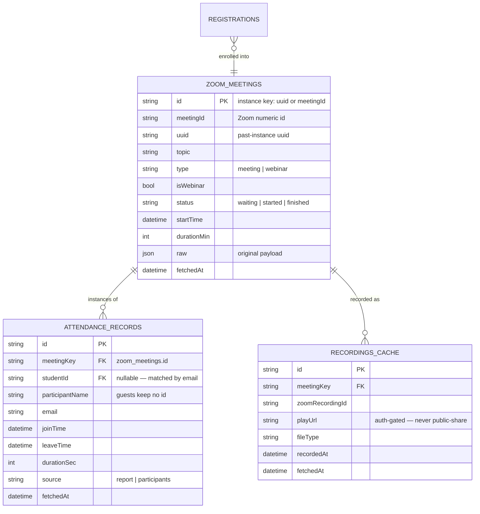

# ER Diagram & Database Design — SBC-LMS

> **Status: implemented.** The core schema below (§2) is live in
> `server/db.js`, backed by Node's built-in `node:sqlite` (SQLite 3.47) — no
> native npm dependency. Repositories live in `server/repos.js`; run
> `npm run db:import` to migrate legacy `server/*.json`. The **Zoom mirror**
> (§3) is an optional next step and is not yet created.

Planning doc for replacing the flat JSON stores (`server/*.json`) with a real
database. Motivation: **speed** (no more whole-file read/write per request),
**security** (hashed tokens & PINs, row-level scoping), **data-loss protection**
(transactions instead of last-write-wins file rewrites) and **hosting**
(managed DB in the cloud).

---

## 1. What is persisted today

| JSON file | Entity today | Endpoints using it |
|---|---|---|
| `students.json` | array of students (with nested `batches[]`) | `/auth/*`, `/students`, `/my-classes` |
| `batches.json` | array of batches | `/students`, `/batches`, `/my-classes`, enroll |
| `targets.json` | map `meetingId → {batchIds[], registrations[]}` | `/targets`, `/meetings/:id/enroll`, `/my-classes` |
| `questions.json` | Q&A audit log (bounded to 5 000 rows) | `/questions`, `/questions/:id` PATCH, `/knowledge` |
| `knowledge.json` | promoted Q&A pairs for the bot | `/questions/promote`, `/knowledge` |
| `chats.json` | map `userKey → messages[]` (last 60) | `/chats/:key` GET/PUT |
| `materials.json` | reference library | `/materials` CRUD |
| *in-memory only* | auth sessions (`Map`, 12 h TTL) | `/auth/*`, API gate |
| *Zoom live API* | meetings, webinars, recordings, roster, coverage, attendance, report | proxied, 5-min roster cache |

Weaknesses of the current design the schema below fixes:

- **Lost updates** — every write rewrites the entire file; two concurrent
  requests = last-write-wins. A crash mid-write truncates the store.
- **Secrets in the clear** — `ADMIN_PIN` / `STUDENT_PASSCODE` live in `.env`
  as plaintext; bearer tokens are held raw in memory.
- **Sessions die on restart** — deploying logs everyone out.
- **No history** — Zoom attendance older than the report window is gone
  forever; nothing durable is kept.

---

## 2. ER diagram — core (owned) data

```mermaid
erDiagram
    STUDENTS ||--o{ STUDENT_BATCHES : "enrolled in"
    BATCHES ||--o{ STUDENT_BATCHES : "contains"
    MEETING_TARGETS ||--o{ MEETING_TARGET_BATCHES : "targets"
    BATCHES ||--o{ MEETING_TARGET_BATCHES : "assigned via"
    MEETING_TARGETS ||--o{ REGISTRATIONS : "auto-registers"
    STUDENTS ||--o{ REGISTRATIONS : "registered for"
    STUDENTS ||--o{ CHAT_CONVERSATIONS : "owns one"
    CHAT_CONVERSATIONS ||--o{ CHAT_MESSAGES : "contains"
    KNOWLEDGE }o--o| QUESTIONS : "promoted / corrected from"
    STUDENTS ||--o{ AUTH_SESSIONS : "sign-in sessions"
    STUDENTS ||--o{ ATTENDANCE_RECORDS : "matched (optional mirror)"

    STUDENTS {
        string id PK "stu-…"
        string name
        string email "login identity + Zoom match"
        string passwordHash "personal override (scrypt, NULL = class password)"
        string notes "mentor remarks"
        datetime createdAt
    }
    BATCHES {
        string id PK "bat-…"
        string name
        string description
        datetime createdAt
    }
    STUDENT_BATCHES {
        string studentId PK,FK
        string batchId PK,FK
        datetime joinedAt
    }
    MEETING_TARGETS {
        string meetingId PK "Zoom numeric id"
        string topic
        datetime updatedAt "last (re)enroll"
    }
    MEETING_TARGET_BATCHES {
        string meetingId PK,FK
        string batchId PK,FK
    }
    REGISTRATIONS {
        string meetingId PK,FK
        string studentId PK,FK
        string name "snapshot"
        string email "snapshot"
        string joinUrl "personal Zoom link — sensitive"
        datetime registeredAt
    }
    QUESTIONS {
        string id PK "q-…"
        text question
        text answer "current (mentor-editable)"
        text aiAnswer "original bot answer"
        string askedBy "display name"
        string role "admin | participant"
        string studentId FK "nullable, participants"
        string source "chatbot | zoom-qa"
        string topic "session topic"
        string meetingId "zoom-qa only"
        string meetingUuid "zoom-qa only"
        datetime askedAt
        string editedBy
        datetime editedAt
    }
    KNOWLEDGE {
        string id PK "kb-…"
        string question "UNIQUE lower(question)"
        text answer
        string source "knowledge | qa-edit"
        string questionId FK "nullable provenance"
        datetime createdAt
    }
    CHAT_CONVERSATIONS {
        string key PK "'admin' | student id"
        string studentId FK,UK "nullable for the admin row"
        datetime updatedAt
    }
    CHAT_MESSAGES {
        string id PK "kb-uid"
        string conversationKey PK,FK
        int seq "stable order"
        string sender "user | bot"
        text text "≤4000 chars"
        string msgTime "display string, e.g. '5:34 pm'"
        datetime createdAt "server clock — sortable"
        string source "'knowledge' | 'mentor-approved' …"
        string mode "session | …"
        bool corrected "mentor-corrected bubble"
    }
    MATERIALS {
        string id PK "mat-…"
        string title
        string category "Beginner | …"
        string type "Reference Guide | …"
        string url
        text description
        int bookmarks
        datetime createdAt
        datetime updatedAt
    }
    AUTH_SESSIONS {
        string tokenHash PK "sha256(token) — never the raw token"
        string role "admin | participant"
        string studentId FK "nullable for admin"
        datetime createdAt
        datetime expiresAt "12 h TTL"
        datetime lastSeenAt
        datetime revokedAt "soft logout"
    }
    ADMINS {
        string id PK "'admin' (single row today)"
        string name
        string pinHash "scrypt(ADMIN_PIN)"
        datetime updatedAt
    }
    SETTINGS {
        string key PK "'class_password' …"
        string value "hashed where sensitive"
    }
```



Cardinality summary:

| Relation | Type | Notes |
|---|---|---|
| students ↔ batches | **M:N** | was a nested array inside each student — now a junction |
| meeting_targets ↔ batches | **M:N** | which batches a scheduled meeting was aimed at |
| students ↔ meeting_targets | **M:N with data** | `registrations` carries the personal join URL + snapshots |
| students ↔ chat_conversations | **1:1** | `key` = `'admin'` (no student) or the student id |
| chat_conversations ↔ chat_messages | **1:N** | ordered by `seq`; capped at 60 by the app |
| questions → knowledge | **0..N:0..1** | a promoted/edited answer links back to its source question |
| students ↔ auth_sessions | **1:N** | admin sessions have `studentId = NULL` |

## 3. ER diagram — optional Zoom mirror (recommended)

Not owned today — fetched live on every page load and lost to Zoom's report
window afterwards. Mirroring makes pages instant and gives you permanent
attendance history.



---

## 4. DDL (SQLite-first, portable to Postgres)

`TEXT` ids keep the existing `stu-`/`bat-`/`q-`/`kb-`/`mat-` prefixes so the
frontend and every stored URL stay valid; timestamps are ISO-8601 `TEXT`
matching today's `new Date().toISOString()` output.

```sql
-- ── core LMS ────────────────────────────────────────────────────────────
CREATE TABLE students (
  id            TEXT PRIMARY KEY,
  name          TEXT NOT NULL,
  email         TEXT NOT NULL DEFAULT '',       -- login identity + Zoom match
  notes         TEXT NOT NULL DEFAULT '',
  password_hash TEXT,                           -- personal override (scrypt); NULL = class password
  created_at    TEXT NOT NULL
);
CREATE INDEX idx_students_name ON students(name);

CREATE TABLE batches (
  id          TEXT PRIMARY KEY,
  name        TEXT NOT NULL,
  description TEXT NOT NULL DEFAULT '',
  created_at  TEXT NOT NULL
);

CREATE TABLE student_batches (
  student_id TEXT NOT NULL REFERENCES students(id) ON DELETE CASCADE,
  batch_id   TEXT NOT NULL REFERENCES batches(id)   ON DELETE CASCADE,
  joined_at  TEXT NOT NULL,
  PRIMARY KEY (student_id, batch_id)
);
CREATE INDEX idx_student_batches_batch ON student_batches(batch_id);

-- ── scheduling & auto-registration ──────────────────────────────────────
CREATE TABLE meeting_targets (
  meeting_id  TEXT PRIMARY KEY,          -- Zoom numeric id as TEXT
  topic       TEXT NOT NULL DEFAULT '',
  updated_at  TEXT NOT NULL
);

CREATE TABLE meeting_target_batches (
  meeting_id TEXT NOT NULL REFERENCES meeting_targets(meeting_id) ON DELETE CASCADE,
  batch_id   TEXT NOT NULL REFERENCES batches(id)                 ON DELETE CASCADE,
  PRIMARY KEY (meeting_id, batch_id)
);

CREATE TABLE registrations (
  meeting_id    TEXT NOT NULL REFERENCES meeting_targets(meeting_id) ON DELETE CASCADE,
  student_id    TEXT NOT NULL REFERENCES students(id)                ON DELETE CASCADE,
  name          TEXT NOT NULL DEFAULT '',   -- snapshot at register time
  email         TEXT NOT NULL DEFAULT '',
  join_url      TEXT NOT NULL,              -- personal Zoom link: sensitive
  registered_at TEXT NOT NULL,
  PRIMARY KEY (meeting_id, student_id)
);
CREATE INDEX idx_registrations_student ON registrations(student_id);

-- ── Q&A audit log & bot knowledge ───────────────────────────────────────
CREATE TABLE questions (
  id           TEXT PRIMARY KEY,
  question     TEXT NOT NULL,
  answer       TEXT NOT NULL DEFAULT '',   -- current wording (mentor-editable)
  ai_answer    TEXT NOT NULL DEFAULT '',   -- original bot answer
  asked_by     TEXT NOT NULL DEFAULT '',
  role         TEXT NOT NULL DEFAULT 'participant',
  student_id   TEXT REFERENCES students(id) ON DELETE SET NULL,
  source       TEXT NOT NULL DEFAULT 'chatbot',   -- chatbot | zoom-qa
  topic        TEXT NOT NULL DEFAULT '',
  meeting_id   TEXT NOT NULL DEFAULT '',
  meeting_uuid TEXT NOT NULL DEFAULT '',
  asked_at     TEXT NOT NULL,
  edited_by    TEXT,
  edited_at    TEXT
);
CREATE INDEX idx_questions_asked_at ON questions(asked_at DESC);
CREATE INDEX idx_questions_student  ON questions(student_id);

CREATE TABLE knowledge (
  id          TEXT PRIMARY KEY,
  question    TEXT NOT NULL,
  answer      TEXT NOT NULL,
  source      TEXT NOT NULL DEFAULT 'knowledge',  -- knowledge | qa-edit
  question_id TEXT REFERENCES questions(id) ON DELETE SET NULL,
  created_at  TEXT NOT NULL
);
CREATE UNIQUE INDEX uq_knowledge_question ON knowledge(lower(question));

-- ── chat (server-side, cross-browser) ───────────────────────────────────
CREATE TABLE chat_conversations (
  key        TEXT PRIMARY KEY,                 -- 'admin' | student id
  student_id TEXT UNIQUE REFERENCES students(id) ON DELETE CASCADE,
  updated_at TEXT NOT NULL
);

CREATE TABLE chat_messages (
  id               TEXT PRIMARY KEY,
  conversation_key TEXT NOT NULL REFERENCES chat_conversations(key) ON DELETE CASCADE,
  seq              INTEGER NOT NULL,
  sender           TEXT NOT NULL CHECK (sender IN ('user','bot')),
  text             TEXT NOT NULL,
  msg_time         TEXT NOT NULL DEFAULT '',   -- display string
  created_at       TEXT NOT NULL,              -- server clock, sortable
  source           TEXT,
  mode             TEXT,
  corrected        INTEGER NOT NULL DEFAULT 0,
  UNIQUE (conversation_key, seq)
);

-- ── library ─────────────────────────────────────────────────────────────
CREATE TABLE materials (
  id          TEXT PRIMARY KEY,
  title       TEXT NOT NULL,
  category    TEXT NOT NULL DEFAULT '',
  type        TEXT NOT NULL DEFAULT '',
  url         TEXT NOT NULL,
  description TEXT NOT NULL DEFAULT '',
  bookmarks   INTEGER NOT NULL DEFAULT 0,
  created_at  TEXT NOT NULL,
  updated_at  TEXT NOT NULL
);

-- ── auth & config (security upgrades) ───────────────────────────────────
CREATE TABLE auth_sessions (
  token_hash   TEXT PRIMARY KEY,        -- sha256(raw token)
  role         TEXT NOT NULL CHECK (role IN ('admin','participant')),
  student_id   TEXT REFERENCES students(id) ON DELETE CASCADE,
  created_at   TEXT NOT NULL,
  expires_at   TEXT NOT NULL,
  last_seen_at TEXT,
  revoked_at   TEXT
);
CREATE INDEX idx_sessions_expiry ON auth_sessions(expires_at);

CREATE TABLE admins (
  id        TEXT PRIMARY KEY,           -- single row: 'admin'
  name      TEXT NOT NULL DEFAULT '',
  pin_hash  TEXT NOT NULL,              -- scrypt
  updated_at TEXT NOT NULL
);

CREATE TABLE settings (
  key   TEXT PRIMARY KEY,               -- 'class_password', …
  value TEXT NOT NULL                   -- hashed where sensitive
);

-- ── optional Zoom mirror (recommended) ──────────────────────────────────
CREATE TABLE zoom_meetings (
  id           TEXT PRIMARY KEY,        -- uuid when known, else meetingId
  meeting_id   TEXT NOT NULL,
  uuid         TEXT,
  topic        TEXT NOT NULL DEFAULT '',
  type         TEXT NOT NULL DEFAULT 'meeting',
  is_webinar   INTEGER NOT NULL DEFAULT 0,
  status       TEXT,
  start_time   TEXT,
  duration_min INTEGER,
  raw          TEXT,
  fetched_at   TEXT NOT NULL
);
CREATE INDEX idx_zoom_meetings_meeting ON zoom_meetings(meeting_id);

CREATE TABLE attendance_records (
  id               TEXT PRIMARY KEY,
  meeting_key      TEXT NOT NULL REFERENCES zoom_meetings(id) ON DELETE CASCADE,
  student_id       TEXT REFERENCES students(id) ON DELETE SET NULL,
  participant_name TEXT NOT NULL DEFAULT '',
  email            TEXT NOT NULL DEFAULT '',
  join_time        TEXT,
  leave_time       TEXT,
  duration_sec     INTEGER,
  source           TEXT NOT NULL DEFAULT 'report',
  fetched_at       TEXT NOT NULL
);
CREATE INDEX idx_attendance_meeting ON attendance_records(meeting_key);
CREATE INDEX idx_attendance_student ON attendance_records(student_id);

CREATE TABLE recordings_cache (
  id                TEXT PRIMARY KEY,
  meeting_key       TEXT NOT NULL REFERENCES zoom_meetings(id) ON DELETE CASCADE,
  zoom_recording_id TEXT NOT NULL,
  play_url          TEXT NOT NULL,
  file_type         TEXT,
  recorded_at       TEXT,
  fetched_at        TEXT NOT NULL
);
```

Postgres adjustments: swap `INTEGER` auto ids if you ever add surrogates
(`BIGSERIAL`), use `TIMESTAMPTZ` instead of ISO `TEXT` if you prefer native
types, and `CHECK`/expression unique indexes work unchanged.

---

## 5. How the schema delivers your four goals

**Speed**
- `jsonStore` rewrites the *whole file* on every mutation and re-reads it on
  every request (students list is loaded ~8× per dashboard render). The DB
  does indexed point lookups — `registrations PK (meeting_id, student_id)`
  makes enroll/attendance checks O(log n).
- With the Zoom mirror, Dashboard/My Classes/Roster answer from local rows
  instead of 5+ Zoom round-trips per page (Zoom adds ~300–800 ms each).
- `GET /knowledge` today loads **all** questions to merge edited answers; a
  single indexed query (`WHERE edited_at IS NOT NULL`) replaces it.

**Security**
- `auth_sessions.token_hash`: the raw bearer token never touches disk; DB
  compromise ≠ session hijack. `revoked_at` gives instant, durable logout.
- `admins.pin_hash` / `settings.class_password` / `students.password_hash`:
  scrypt hashes (the `.env` values are seeds only, hashed on boot);
  constant-time compare on login.
- `questions.student_id` replaces name-based attribution ("respective users"
  becomes a real FK — the edited-answer visibility feature stops guessing by
  name matching).
- `registrations.join_url` and `recordings_cache.play_url` are marked
  sensitive: keep the participant gate (own-row only), and never expose them
  in list endpoints that a guest could reach.
- SQL parameterisation end-to-end (no string-built queries).

**Data-loss protection**
- Every mutation becomes a transaction: `DELETE`-old-`INSERT`-new for the
  enroll flow (today: read file → mutate array → write file, twice, racing).
- Crash mid-write can no longer truncate `students.json`-equivalent state.
- Unique `knowledge(lower(question))` enforces the dedupe rule the JS
  currently implements by scanning.
- `attendance_records` / `recordings_cache` preserve history Zoom's report
  window (≈1 month) forgets.
- Backups: `pg_dump` cron / managed snapshots (Postgres) or Litestream /
  scheduled file copy (SQLite).

**Deployment / hosting**
- One `DATABASE_URL` env var; the eight `*.json` files disappear from the
  deploy artifact — no more lost-update worries when you run two instances.
- Sessions in the DB mean restarts/deploys don't log users out.
- SQLite (embedded, zero-ops) works for a single VPS; moving to managed
  Postgres (Neon, Supabase, RDS) needs only the driver + `DATABASE_URL`
  because the schema above is portable.

---

## 6. Suggested migration path (JSON → DB, low risk)

1. **Driver** — `npm i better-sqlite3` (sync, fastest for this app) or
   `pg`/`@neondatabase/serverless` for hosted Postgres. A thin `db.js`
   exporting `query/all/run` keeps the choice swappable.
2. **Repository layer** — replace `studentsStore.read()/write()` etc. with
   `repos/students.js` (`list`, `get`, `create`, `update`, `remove`) so the
   ~40 endpoint call-sites change mechanically, not architecturally.
3. **One-shot importer** — `scripts/import-json-to-db.js` reads the seven
   JSON files and inserts rows (conversations: rebuild `seq` and
   `created_at`; questions: keep existing ids so edited-answer links stay
   valid). Run once, keep the JSON files as a backup archive.
4. **Sessions** — move the in-memory `Map` into `auth_sessions` (hash the
   token on issue, verify on each request, purge `expires_at < now` on boot).
5. **Zoom mirror** — background refresh (e.g. every 15 min, or after
   schedule/enroll actions) writes `zoom_meetings` + `attendance_records`;
   endpoints read local-first with `fetched_at` staleness fallback to live.
6. **Cutover** — API reads DB only; delete `jsonStore` and the `.json`
   files from `server/` once verified (`npm test` with a temp DB file per
   run keeps the suite hermetic).

---

## 7. Store → table cheat sheet

| Today (`server/*.json`) | Becomes |
|---|---|
| `students.json` (`batches: []` nested) | `students` + `student_batches` |
| `batches.json` | `batches` |
| `targets.json` (`{meetingId: {batchIds, registrations}}`) | `meeting_targets` + `meeting_target_batches` + `registrations` |
| `questions.json` | `questions` (+ `student_id` FK) |
| `knowledge.json` | `knowledge` (+ provenance FK, unique question) |
| `chats.json` (`{key: messages[]}`) | `chat_conversations` + `chat_messages` |
| `materials.json` | `materials` |
| in-memory sessions `Map` | `auth_sessions` (hashed tokens) |
| `.env` `ADMIN_PIN`, `STUDENT_PASSCODE` | `admins.pin_hash`, `settings.class_password` (both scrypt) |
| Zoom live-only (attendance, meetings, recordings) | `zoom_meetings`, `attendance_records`, `recordings_cache` (optional mirror) |
